<p align="center">
  
</p>

> **AirDrop beta testing — R49:** Testers with Intel **BE200, AX210, AX211 and AX201** are welcome.
> [Jump to Beta testing](#beta-testing) for the tested setup, known limitations and screenshots.
> **Bluetooth update:** use the [BlueToolFixup 2.7.6 compatibility hotfix](#bluetoolfixup-276-compatibility-hotfix) with R49.
> **2.0.0 remains the regular Wi-Fi release.**

# AirportItlwm-Tahoe 2.0.0

**Intel Wi-Fi for macOS Tahoe with AppleVTD / IOMMU support**

**Intel BE200 · AX210 · AX201 · AX211**<br>
**VHT · HE · HE + BF**

Intel Wi-Fi for macOS Tahoe, with native macOS Wi-Fi integration through the
Ventura Legacy stack. The intended driver paths support DMA mapping through
the system IOMapper while keeping AppleVTD enabled in the documented setup.
Device-specific conventional paths remain supported; AppleVTD being active
and this Wi-Fi device actually using mapped DMA are separate facts.

**[Download 2.0.0](https://github.com/kgp-macPro/AirportItlwm-Tahoe/releases/download/v2.0.0/AirportItlwm-Tahoe-2.0.0.zip)** ·
[Regular Latest release](https://github.com/kgp-macPro/AirportItlwm-Tahoe/releases/latest) ·
[Release + r14 SHA256 checksums](https://github.com/kgp-macPro/AirportItlwm-Tahoe/releases/download/v2.0.0/SHA256SUMS-r14.txt) ·
[Installation](INSTALL.md) · [Modes and benchmark guide](docs/benchmark/README.md)

**Required: [OCLP-CustoMac 3.0.0 or newer](https://github.com/kgp-macPro/OCLP-CustoMac/releases),
with the matching root patches for the Ventura Legacy wireless stack.**
OCLP-CustoMac supplies the Apple framework/patch environment, including the
legacy wireless dependencies; AirportItlwm-Tahoe supplies the separate Intel
driver and its device-specific DMA implementation. The kext alone does not
replace root patching. This is not a native Tahoe/Sonoma Skywalk frontend port.

## Start here

1. Read [installation and rollback](INSTALL.md), verify your OCLP-CustoMac patch
   state, and install the complete `AirportItlwm.kext` manually.
2. Choose VHT (no HE/BF opt-in), HE (`-itlwmhe`) or HE with optional SU-Beamformee
   (`-itlwmhe -itlwmbf`). Do not use `-novht` for these VHT/HE campaigns.
3. Check the loaded build, PCI-to-driver-to-interface binding and actual DMA
   mode; then use the [complete r14 benchmark package](https://github.com/kgp-macPro/AirportItlwm-Tahoe/releases/download/v2.0.0/AirportItlwm-Tahoe-Benchmark-Tools-r14.zip).
   The standard 3×20 runner is the VHT starting point; extended RX matrices
   are for HE stress comparisons. A runner's candidate path is an identity
   reference to the already loaded bundle, not an installation command.
   [Verify the r14 ZIP](https://github.com/kgp-macPro/AirportItlwm-Tahoe/releases/download/v2.0.0/AirportItlwm-Tahoe-Benchmark-Tools-r14.zip.sha256);
   [release and r14 asset checksums](https://github.com/kgp-macPro/AirportItlwm-Tahoe/releases/download/v2.0.0/SHA256SUMS-r14.txt).
   r14 changes instructions and package metadata; its runtime files remain r13.

## DMA configuration: mapped and conventional

**AX201/CNVW supports mapped DMA. Fulvio's regular configuration is mapped
Mode 2; conventional is a separate comparison, not an AX201 requirement.**

| DMA configuration | OpenCore Kernel → Quirks → DisableIoMapper | Runner expectation | Actual driver mode |
|---|---|---|---|
| mapped | **false** | `EXPECTED_MODE=mapped` | **Mode 2** |
| conventional | **true** | `EXPECTED_MODE=conventional` | **Mode 1** |

**Reboot after changing the EFI quirk or Wi-Fi boot arguments.** These are
manual test configurations. Record active AppleVTD separately for mapped;
the flag alone is not runtime proof. `EXPECTED_MODE` checks the loaded driver's
actual mode and cannot select it. Keep every identity, binding and health guard.

## Device, mode and validation scope

| Device / path | VHT evidence | HE / HE+BF opt-in evidence | DMA boundary |
|---|---|---|---|
| **BE200**, PCI 8086:272B, BZ/GL92 |P10, 60 tests +online; VHT160|P10, six campaigns / 360 tests +online, including HE and BF opt-in|AppleVTD active and **mapped** verified in these campaigns|
| **AX210**, PCI 8086:2725 |Historical P10 VHT160, 60 tests +online|Final R9 HE160 /HE+BF-opt-in:180/180 tests +3 online|AppleVTD active and **mapped** verified|
| **AX201 / CNVW** |Fulvio’s 4 Nov **Alpha 2** campaigns:42/42 mapped Mode 2 and42/42 conventional Mode 1, each +online; retain their original build/setup|One **2.0.0 HE160** mapped capture:60/60 +online; BF setting and peer link unknown. Controlled HE/BF comparisons **pending**; some profiles lack firmware 63|Both mapped and conventional configurations are supported where qualified; check the **actual runtime mode**, never infer it from AX201/CNVW naming|
| **AX211** |Historical Alpha 2/P8R1:42/42 **mapped** tests; 80 MHz per KGP, not a 160 MHz proof|AX HE code present; new HE/BF hardware validation **pending**; some profiles lack firmware 63|Use captured runtime mode; historical mapped result does not qualify a new HE build|

Fulvio’s independently checked [Alpha-2 originals from 4 November](docs/AX201_DMA.md#alpha-2-evidence-from-4-november-2026) confirm mapped Mode 2; these are historical results, not new 2.0.0 tests.
Fulvio’s 7 November 2.0.0 original completed 60/60 plus online in mapped Mode 2 and records HE160. Its BF setting and wired-peer link are unknown; this is not a controlled VHT/HE/HE+BF comparison. [Original-data audit](docs/AX201_DMA.md#additional-200-mapped-evidence-from-7-november-2026).
His mapped results supersede the old “AX201/CNVW conventional only” guidance.
Use the [AX201 r14 commands](docs/benchmark/README.md#ax201cnvw-mapped-and-conventional-comparisons):
`AX201-2.0.0` with `EXPECTED_MODE=mapped` for his mapped configuration, or a
separate conventional comparison. `EXPECTED_MODE` **checks**, and never switches,
the driver’s DMA route. See [evidence and correction history](docs/AX201_DMA.md).

2.0.0 is a versioned rebuild of the final tested R9 implementation. Campaigns
retain their original **P10** or **R9** binary UUID/hash; the release binary has
its own identity and was not put through an additional hardware campaign just
for version numbering. See [build identity and provenance](docs/BUILD.md),
[exact code scope](docs/TECHNICAL_LINEAGE.md) and [all results](docs/results/2.0.0.md).
A retail label or shared profile name is not device or hardware-validation proof.

### Planned development: BE200 Wi-Fi 7

BE200 Wi-Fi 7 (802.11be/EHT) support is planned for a future release. We intend to complete implementation and hardware validation once a FRITZ!Repeater 6700 Pro is available for our test setup.

Wi-Fi 7 is not included in version 2.0.0. The final feature scope and release timing will depend on successful implementation and hardware testing.

The planned test hardware is a prerequisite, not a promise of immediate
completion. No EHT/MLO/6 GHz/320 MHz support is claimed in 2.0.0 from the BE200
name or the AP's marketing capabilities.

## What changed

- gsfront's [original PR #5](https://github.com/kgp-macPro/AirportItlwm-Tahoe/pull/5) is regularly merged into its original
  `be200-alpha` base, preserving both commits and authorship. BE200 HE/BF,
  HE capabilities, link/station setup, frame release and the earlier 256-entry
  HE RX BA/reordering support are retained.
- The AX201/AX210/AX211 HE path is adapted from pinned
  [laobamac 7204c69](https://github.com/laobamac/itlwm/tree/7204c69d1bfa7f5cc0f7864e08fb03e55d0ec29e)
  for our existing Legacy frontend, NVM/firmware gates and AX command formats.
- **Firmware rate reporting:** AX HE and HE+BF use the newest coherent
  TLC/BA feedback tuple for rate, MCS, NSS, width and GI. This is firmware
  reporting, not a PHY measurement of every packet. Idle last-known values
  have separate age/freshness diagnostics; no fixed 2401/MCS11 is forced.
- **Earlier AX-HE packet handoff:** mapped non-BZ HE RX publishes safely
  replaced-buffer credits and delivers after 32 completions or at least 64
  ready packets, at a completion boundary. Larger atomic releases remain
  intact. This is separate from the **already existing 256-entry BA window**.
  VHT and conventional RX do not execute this budget. BE200 already has its
  own 32-completion service and is not given AX commands or a duplicate fix.

## Required wired-peer link modes

| Wi-Fi test mode | Required wired peer link for comparable campaigns |
|---|---|
| VHT | **1000Base-T / 1 Gbit/s** |
| HE | **2500Base-T / 2.5 Gbit/s** |
| HE + BF opt-in | **2500Base-T / 2.5 Gbit/s** |

**Do not use 5000Base-T or 10GBase-T for these comparison campaigns.** The OWC
adapter supports 10 GbE but must be limited to the appropriate mode. Verify and
record the *negotiated* media on the wired peer. These are this project's
comparison-method conditions, not general IEEE requirements for HE.

## AX210: complete R9 campaigns

Receiver throughput, Mbit/s, arithmetic mean of three rounds. Each campaign
completed 60 iperf3 tests and its final Internet test. In 288 recorded TCP sum
intervals there were no complete zero intervals. Remaining retries and loss
are retained below and in the detail data.

| Recorded campaign | Mode / UDP matrix | TX P1 | TX P4 | RX P1 | RX P4 |
|---|---|---:|---:|---:|---:|
| `AX210-P10R9_AX210_3X20_TX600_RX1300` | HE / RX1300 | 697.7 | 689.4 | 1668.2 | 1876.6 |
| `AX210-P10R9_AX210_3X20_TX600_RX1700` | HE / RX1700 | 697.2 | 687.4 | 1700.3 | 1861.9 |
| `AX210-P10R9_AX210_3X20_TX600_RX1700` | HE+BF opt-in / RX1700 | 696.9 | 688.4 | 1693.3 | 1887.6 |

<details>
<summary>AX210 HE160 screenshot</summary>

[Open original resolution](Assets/2.0.0/AX210-HE.png)

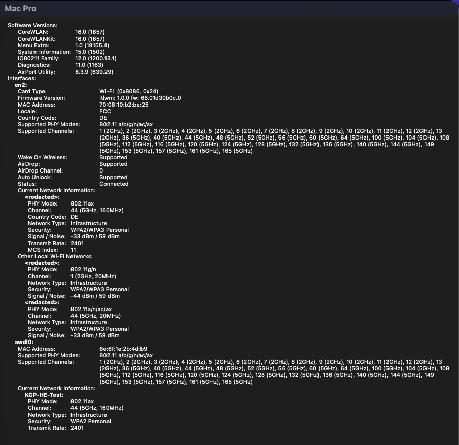

Original HE screenshot. It has no UUID and is not by itself proof of the R9 build. The table is pinned by the archives, not the image. Historical internal 1.0.0 text is intentionally unchanged.

</details>
<details>
<summary>AX210 HE160 with BF opt-in: 2401 Mbit/s and MCS11</summary>

[Open original resolution](Assets/2.0.0/AX210-HE-BF.png)

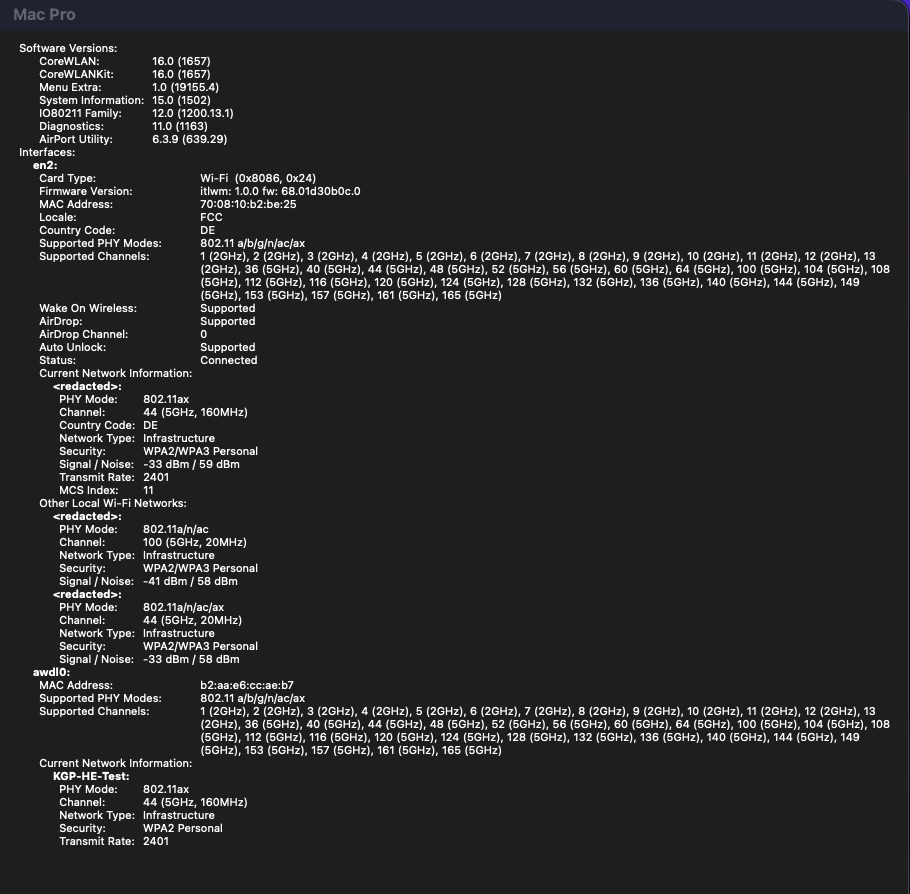

AX210 HE160 with optional HE SU-Beamformee support, hardware-tested with the opt-in enabled. KGP confirmed both boot arguments; the screenshot alone does not prove on-air beamforming or its performance effect.

</details>

**Residuals:** TCP P4 retransmits remain. Completion of a UDP stress test does
not mean loss-free operation. HE-only RX1700 reported about 35% loss in all
three rounds; RX1500 had one 20.4% run, and the UDP1300 campaign included a
35.2% RX1000 spike. Under BF opt-in every RX stage through 1500 reported 0%
in all rounds; RX1700 was about 34%, 35%, 0%, with about 1705 Mbit/s received in
the last round. All other spikes and UDP TX losses are in the
[per-round detail](docs/results/2.0.0.md). These runs do not isolate BF effect.

The successful R9 short control probe completed at 1195 Mbit/s UDP reception;
its result-request ACK took 0.167 ms versus 9.952 s in the failed R8 probe.
A later server 117/9 teardown after completed result exchange is documented
separately. Additional manual P1 observations were about 1.71 Gbit/s RX and
698 Mbit/s receiver TX, without retransmits; they are not pooled into the tables.

### Historical AX210 P10 VHT, not an R9 VHT test

| Recorded campaign | Mode / UDP matrix | TX P1 | TX P4 | RX P1 | RX P4 |
|---|---|---:|---:|---:|---:|
| `AX210-P10_AX210_3X20` | VHT / RX900 | 387.6 | 440.4 | 854.5 | 896.3 |

<details>
<summary>Historical AX210 P10 VHT160 screenshot</summary>

[Open original resolution](Assets/2.0.0/AX210-VHT.png)

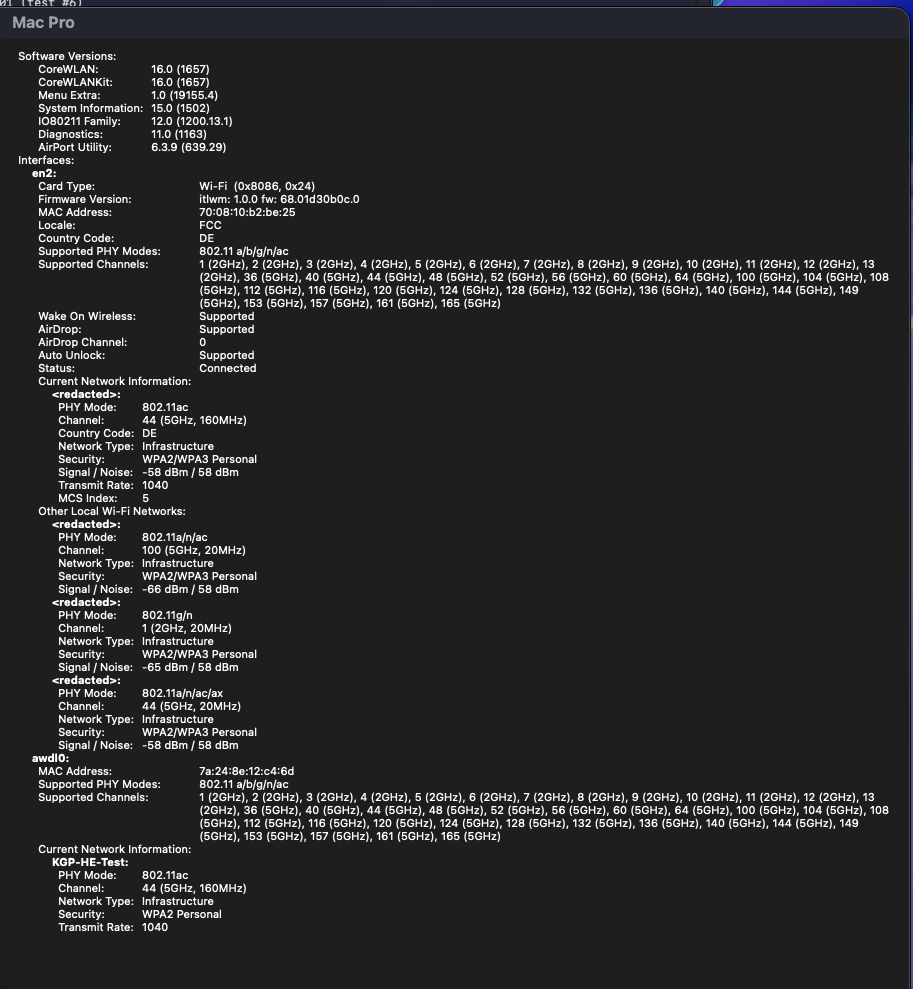

Historical P10 with HE/BF off: 802.11ac, channel 44/160 MHz. No R9-VHT hardware claim is derived from it.

</details>

## BE200: VHT, HE and HE+BF already tested

Seven P10 archives: 420/420 tests and seven final online tests; 382 manifest
checks per archive. These pin the original P10 binary, not the new release
UUID. Different standard/stress matrices and early versus later testbed
conditions are displayed separately, not pooled or treated as a BF A/B test.

| Recorded campaign | Mode / UDP matrix | TX P1 | TX P4 | RX P1 | RX P4 |
|---|---|---:|---:|---:|---:|
| `BE200-P10_BE200_3X20` | VHT / RX900 | 633.2 | 587.4 | 914.0 | 922.2 |
| `BE200-P10_BE200_3X20` | HE / RX900 | 362.4 | 436.5 | 931.7 | 931.8 |
| `BE200-P10_BE200_3X20` | HE+BF opt-in / RX900 | 312.0 | 431.9 | 934.5 | 933.5 |
| `BE200-P10_BE200_3X20` | HE+BF opt-in / RX900 | 699.4 | 677.6 | 1688.0 | 1867.8 |
| `BE200-P10_BE200_3X20_TX600_RX1700` | HE+BF opt-in / RX1700 | 696.9 | 678.7 | 1702.0 | 1883.7 |
| `BE200-P10_BE200_3X20_TX600_RX1700` | HE / RX1700 | 694.2 | 681.3 | 1684.3 | 1858.1 |
| `BE200-P10_BE200_3X20_TX600_RX1600` | HE / RX1600 | 697.5 | 679.4 | 1660.8 | 1825.4 |

The VHT campaign exists; its screenshot is missing. No replacement image or
additional test was created. Its saved `ItlwmHeLink=not-he` supports the KGP
VHT assignment; absent HE setup properties alone are not boot-argument proof.
The HE/BF provider properties distinguish the six HE campaigns.

<details>
<summary>BE200 P10 HE160 screenshot</summary>

[Open original resolution](Assets/2.0.0/BE200-HE.png)

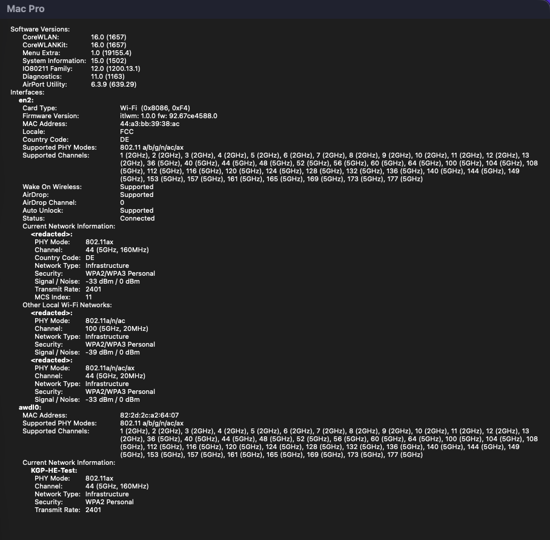

Original tested P10 context, firmware 92.67ce4588.0. The displayed PHY rate is not payload goodput or proof of the new release UUID.

</details>
<details>
<summary>BE200 P10 HE160 with beamformee opt-in screenshot</summary>

[Open original resolution](Assets/2.0.0/BE200-HE-BF.png)

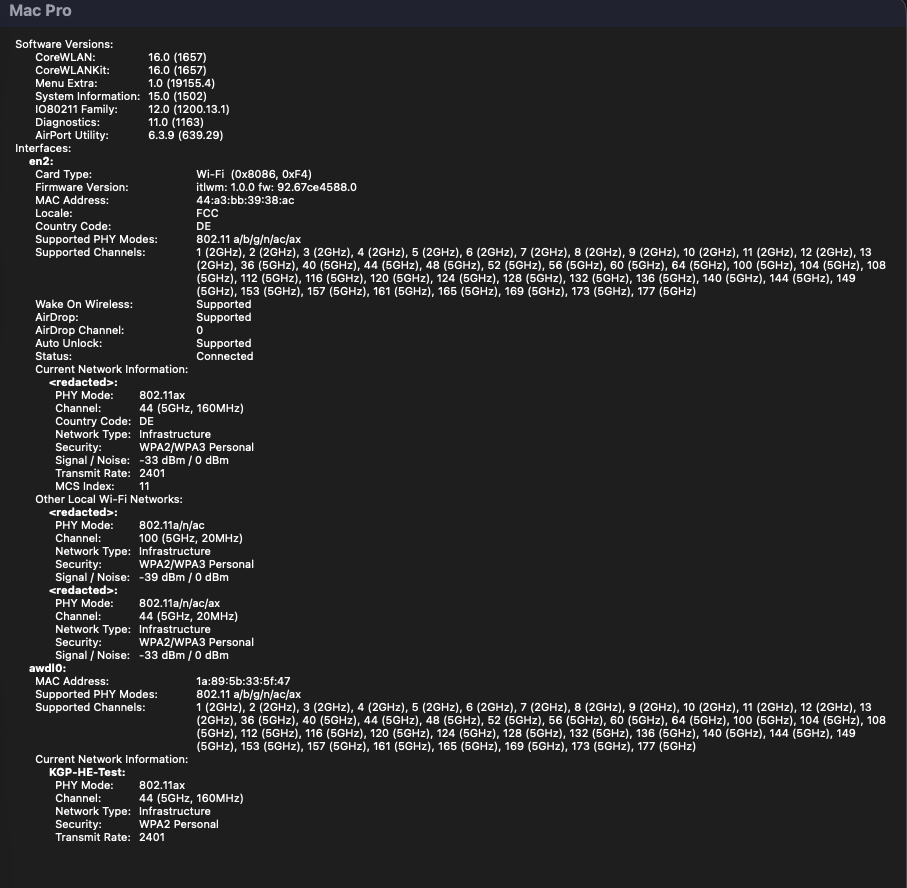

Original P10 HE+BF-opt-in context; retained unchanged. See the [tested Bluetooth configuration](#tested-bluetooth-configuration) used with this setup.

</details>

## Reference system and network

| Component | KGP's documented setup |
|---|---|
| Main system |ASUS WS X299 Sage/10G; Intel Core i9-7980XE ; 128 GB RAM; AMD Radeon VII; SMBIOS MacPro7,1|
| Existing Ethernet |Intel X550-AT2 with IntelLucy|
| IOMMU |AppleVTD enabled; these BE200/AX210 campaigns captured actual mapped mode|
| OS in campaign preflights |macOS Tahoe 26.7.2 / 25G332; not a KDK version or a claim about every installed OS|
| Router / switch |FRITZ!Box 7590; MikroTik CRS309 with S+RJ10|
| Wi-Fi AP |Mercusys MR27BE in AP mode; 5 GHz, channel 44, 160 MHz, WPA2/WPA3 Personal|
| Wired peer |MacBook Pro 13-inch M1 (2020), OWC 10 GbE adapter, manually limited as above|
| Tools |iperf 3.22, cJSON 1.7.15 as captured/reported|
| Internet service |80 Mbit/s down / 30 Mbit/s up; limits Internet networkQuality, not local iperf3|

Our AX210 address/interface were `en2 / 192.168.178.135`; the MBP server was
`192.168.178.197:5201`. Public commands below use the tester's own interface/IP.
Historical client archives do not independently measure the peer's physical
link; record it explicitly for new comparisons rather than retroactively
inferring it from throughput or the adapter's 10 GbE capability.

We recommend the inexpensive [Mercusys MR27BE](https://www.mercusys.com/de/product/wifi-router/mr27be/)
as an interim AP for reproducing this setup while a later network upgrade is
planned: roughly €50–55 before retailer/shipping differences (for example,
[a retailer listing](https://www.alza.de/mercusys-mr27be-levne-d12786466.htm)).
Check current total price; no future FRITZ!Repeater availability date is asserted.
The AP's Wi-Fi 7 marketing is not a driver capability claim.

<details>
<summary>AX210 PCI 8086:2725 hardware binding</summary>

[Open original resolution](Assets/2.0.0/AX210-Hackintool.png)

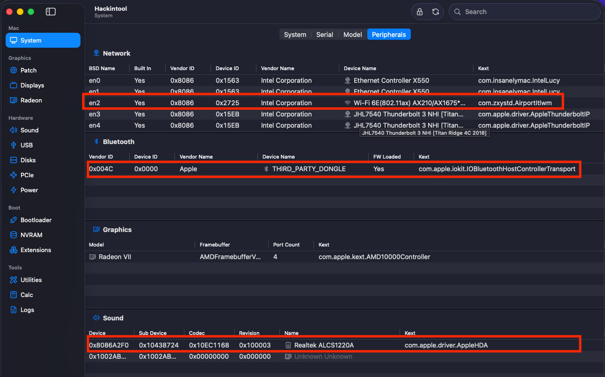

The PCI 8086:2725 identity and loaded AirportItlwm binding take precedence over generic model strings. The Bluetooth line is not physical-chip identification; see the [tested Bluetooth configuration](#tested-bluetooth-configuration).

</details>
<details>
<summary>BE200 PCI 8086:272B hardware binding</summary>

[Open original resolution](Assets/2.0.0/BE200-Hackintool.png)

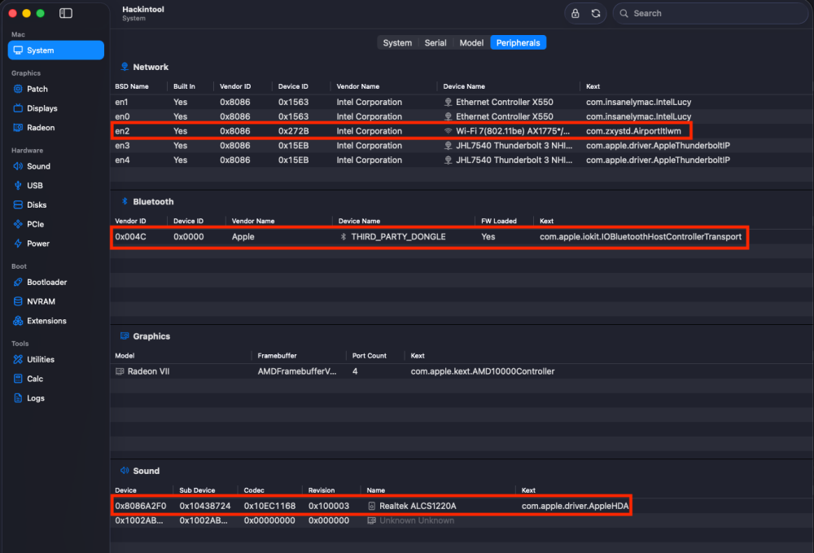

PCI 8086:272B is the BE200 reference. Hackintool may show a generic Wi-Fi 7/AX model label; this is not evidence for EHT in this release. See the separate [tested Bluetooth configuration](#tested-bluetooth-configuration).

</details>

## Tested Bluetooth configuration

| Loaded kext in the BE200-P10 and AX210-R9 preflights | Version | Exact source |
|---|---|---|
| IntelBluetoothFirmware.kext |2.5.1|[lshbluesky v2.5.1](https://github.com/lshbluesky/IntelBluetoothFirmware/releases/tag/v2.5.1)|
| IntelBTPatcher.kext |2.5.1|[lshbluesky v2.5.1](https://github.com/lshbluesky/IntelBluetoothFirmware/releases/tag/v2.5.1)|
| BlueToolFixup.kext |2.7.2|[Acidanthera/BrcmPatchRAM 2.7.2](https://github.com/acidanthera/BrcmPatchRAM/releases/tag/2.7.2)|

These are separate Bluetooth components, not bundled AirportItlwm features.
Follow their own dependencies and instructions. Hackintool's
“Apple / THIRD_PARTY_DONGLE / 0x004C” does not identify the physical Bluetooth
chip. The separate Bananz0 BLE/AWDL analysis is not integrated into2.0.0.

## Limits and historical records

Controlled AX201 HE/BF comparison and AX211 HE/BF hardware validation, some firmware 63 profiles, longer-load/
Sleep-Wake qualification, remaining loss/retry attribution and actual BF-use
proof remain open. Little Snitch and Avast were active according to KGP;
BE200 and AX210-VHT also work with them. No general filter/environment cause
is established. No extra RF capture or hardware campaign was required for 2.0.0.

No new AirDrop/AWDL/BLE functionality is included. A published interface or a
“Supported” label is not a completed AirDrop transfer. Separate experimental
AWDL/BLE work was not merged. [Historical releases, qualification and downloads](docs/HISTORY.md)
remain available, including 1.0.0, 1.1.0 Beta, 1.2.0 Alpha and the old 3×14 runner.

[Technical lineage](docs/TECHNICAL_LINEAGE.md) ·
[Build and identity](docs/BUILD.md) · [License](LICENSE)


---

## Inherited licenses and attribution

Existing LICENSE, source copyrights and firmware/SDK notices remain unchanged. The [preserved upstream README](docs/UPSTREAM_README.md) retains upstream credits in their original context, including Acidanthera/MacKernelSDK, Apple, AppleIntelWiFi, ErrorErrorError, Intel firmware/iwlwifi, Linux, mercurysquad/Voodoo80211, OpenBSD/net80211/iwn/iwm/iwx, pigworlds, rpeshkov/black80211, usr-sse2 and zxystd. This project attribution does not replace those notices.


---

## Beta testing

### Experimental AirDrop — R49

**Testers with Intel BE200, AX210, AX211 and AX201 are welcome.** R49 extends
this project's AppleVTD-capable Wi-Fi driver with experimental native AirDrop.
The aim is to send and receive files through Finder and the normal iPhone
sharing menu while keeping the infrastructure Wi-Fi connection usable.

R49 is a separate experimental pre-release. **2.0.0 remains the regular
infrastructure Wi-Fi release**; the benchmarks and configuration above belong
to that release.

### What works, and what still needs testing

Successful file transfers in both directions have been demonstrated on
**BE200 and AX210**. Earlier BE200 captures established actual AWDL file
transport alongside working Internet access. The final BE200 check with R49
and the matching Bluetooth package confirmed successful Hackintosh ↔ iPhone
transfers and usable Internet access by observation. AX210 R49 recordings
also contain successful bidirectional AWDL transfers. These are different
forms of evidence; the earlier BE200 packet captures are not new R49 captures.

**MacBook Pro ↔ Hackintosh transfers can still be delayed or fail.** Successful
sessions coexist with unsuccessful attempts, and results vary by peer and
session. iPhone transfers have generally been more consistent in the reported
tests. Connection setup, repeatability and transfer speed remain active areas
of development. A visible peer or an active `awdl0` interface alone does not
establish a successful file transfer.

| Card | Beta scope | AirDrop hardware evidence |
|---|---|---|
| **BE200** | GL92 firmware backend; testing welcome. | Bidirectional transfers demonstrated; earlier captured AWDL successes and a final R49 visual check. |
| **AX210** | AX firmware backend; testing welcome. | Bidirectional AWDL transfers captured with R49; delays and failed attempts also recorded. |
| **AX211** | Applicable AX firmware path included; testing welcome. | Additional AirDrop hardware testing is needed. |
| **AX201** | Applicable AX firmware paths included, including the documented CNVW/Mapped-2 configuration; testing welcome. | Existing infrastructure results remain valid; AirDrop hardware testing is needed. |

AX201, AX210 and AX211 share the applicable AX AWDL implementation, with
selection of the transport, firmware and command versions required by the
actual device. This does not make their firmware interchangeable. Existing
AX201 mapped support is retained. Inclusion in this beta invitation does not
mean every card, subsystem or platform has already passed an AirDrop test.

### Where the implementation comes from

This beta combines upstream work with development carried out in the
AirportItlwm-Tahoe project. Its driver foundation remains
**OpenIntelWireless/itlwm and AirportItlwm**, including the OpenBSD networking
code inherited through that project. It continues our Ventura Legacy and
AppleVTD integration, together with the BE200 and AX Wi-Fi work described in
the 2.0.0 section above. R49 continues our P10R9 infrastructure and
R30/R42/R44-derived AWDL line; the separate P1 experiment is not its runtime
foundation.

**Intel/Linux iwlwifi and iwlmvm implementations were ported and adapted**
for the firmware backends. This includes MAC/PHY/LINK resource handling,
AP/GO setup, station types, transmit queues, beacon timing and firmware
command layouts. For BE200, the GL92 backend adapts the appropriate Intel
MLD firmware structures and role/filter contracts. For AX, the GO integration
adapts relevant `mvm/mac-ctxt.c`, `mvm/mac80211.c` and `mvm/sta.c` mechanisms.
These are substantial implementation sources, not just background reading.
They are integrated into our macOS/Legacy and DMA lifetimes; Linux's complete
mac80211/cfg80211 stack is not run here, and Linux does not supply a finished
AirDrop stack. Intel's firmware files retain their separate license.

**Bananz0's AirportItlwm-Tahoe-AWDL work** supplied host-side AWDL foundations
that were retained and adapted: frame templates, protocol parsing and
composition, service information, peer handling, synchronization and channel
sequence structures. The original Glen Muthoka copyright and license notices
remain. That experimental IWM/9560 firmware implementation was not treated as
an interchangeable BE200 or AX backend. The separate Bluetooth package also
adapts BLE patch mechanisms from Bananz0's BrcmPatchRAM-Tahoe-BLE work to the
native image used by our setup.

**laobamac's work and crazyhulk's experimental AWDL implementation in
[laobamac PR #53](https://github.com/laobamac/itlwm/pull/53)** supplied
additional native-integration and P2P/PHY/binding/station mechanisms for
adaptation and comparison. laobamac also supplied the AX HE reference used
for our Legacy adaptation. Their complete WCL/Skywalk frontend, dynamic
listen planning and peer-window buffers were not imported as a single
identical runtime path.

**retropineaple's [ForbiddenItlwm](https://github.com/retropineaple/ForbiddenItlwm)**
is a concrete comparison source for LISTENER roles, receive filters,
infrastructure isolation, peer windows, queues and ACK/Block-Ack behavior.
Its mechanism for omitting optional infrastructure information from AWDL's
Data-Path TLV was specifically adapted here. Our Legacy version retains
additional AWDL address fields. R49 does not import Forbidden's complete
Skywalk packet pools, LISTENER/BA/peer-pause implementation or channel policy.

**Our own integration** connects these contributed and adapted foundations
to the Legacy/native AWDL interface and mapper-aware DMA. It includes typed
native interfaces, original-packet ownership, peer/cache handling, firmware
generations and resource lifetimes, RX/BSS isolation, completion/watchdog
ownership and recovery. Within that integration we developed and checked
the GL92 GO receive-filter correction and subsequent AX startup,
transmit-format and clock-synchronization corrections. Paired captures and
real file arrivals are used to assess the resulting behavior. The combined
implementation is not a byte-for-byte port of any single upstream project.

### What is shared, and what differs

All three projects build on Intel Wi-Fi driver work and use macOS services
for AirDrop discovery, session establishment and file transfer. The driver
provides the AWDL radio/data path; it does not replace Finder or implement a
new AirDrop application. Their frontend and firmware choices differ:

| Area | AirportItlwm-Tahoe R49 | Relationship to the upstream references |
|---|---|---|
| **macOS integration** | Restored Ventura `IO80211FamilyLegacy` environment, with this project's AppleVTD-capable driver. | The compared laobamac/Forbidden native/WCL paths are references; their frontend is not substituted for our Legacy integration. |
| **Channel policy** | Infrastructure primary channel **44**; private AWDL context **44/20 MHz**, without channel hopping. | The examined laobamac PR53 follows channel/peer sequences. Forbidden's policy varies by version: earlier references use 149/6; newer references also handle 44. R49 does not inherit their complete channel policy. |
| **Private data role** | **GO firmware data role, PROMISC off**, with a private PHY context separate from the infrastructure PHY. | The Forbidden LISTENER approach was examined, but is not the shipping R49 data role. GO here describes an Intel firmware role, not the AWDL master-election role. |
| **Card backends** | Separate GL92 and AX firmware adaptations beneath the shared native/host integration. | Command formats, queue handling and station setup follow the actual device and firmware contracts. |
| **Bluetooth** | Separately packaged modified BlueToolFixup plus original IntelBluetoothFirmware and IntelBTPatcher. | This beta uses its own documented Bluetooth setup; Forbidden's BTLEAdvFixup and boot-argument list are not its installation instructions. |

The fixed-channel choice deliberately keeps this beta's scope narrow. The
tested infrastructure connection can retain 160 MHz while the private AWDL
context uses 20 MHz on primary channel 44. Separate firmware PHY contexts do
not mean separate physical radios. Other AP channels and automatic channel
following are outside the documented R49 setup.

### BlueToolFixup 2.7.6 compatibility hotfix

**19 November 2026: use the project-modified BlueToolFixup 2.7.6 with R49.**
The original beta package remains available and still contains 2.7.5; replace
only that Bluetooth kext with the hotfix below. Keep AirportItlwm R49,
IntelBluetoothFirmware 2.5.3, IntelBTPatcher 2.5.3 and the documented boot
arguments unchanged. Installation and restart are manual.

After some Tahoe updates, 2.7.5 could reject otherwise compatible Apple
functions because its checks included addresses that changed between builds.
This could leave the additional BLE patches inactive despite `-kgpble` and a
loaded kext. Our 2.7.6 checks the required instruction layouts while allowing
those address changes. It retains the same eight patch effects and native
initialization. This is our compatibility correction, not an official
Acidanthera 2.7.6 release or an OTA fix.

**After updating to Tahoe 26.7.3 and 26.7.4 RC, successful bidirectional
Hackintosh-iPhone file transfers were confirmed with R49 and BlueToolFixup
2.7.6. These results confirm basic R49 AirDrop functionality on both releases.**

The shared Intel Bluetooth selection remains available for BE200, AX210,
AX211 and AX201; these results do not constitute new physical testing of all
four cards. Discovery can still be
delayed after a restart, and the Mac-to-Mac performance limits remain.
Unknown native layouts skip the additional patches; future macOS support
is not guaranteed.

**[Download BlueToolFixup 2.7.6 hotfix](https://github.com/kgp-macPro/AirportItlwm-Tahoe/releases/download/v2.1.0-beta.1/BlueToolFixup-2.7.6-Tahoe-Hotfix.zip)** ·
[Corresponding hotfix SOURCE.zip](https://github.com/kgp-macPro/AirportItlwm-Tahoe/releases/download/v2.1.0-beta.1/BlueToolFixup-2.7.6-Tahoe-Hotfix-SOURCE.zip) ·
[Hotfix SHA256 checksums](https://github.com/kgp-macPro/AirportItlwm-Tahoe/releases/download/v2.1.0-beta.1/BlueToolFixup-2.7.6-Tahoe-Hotfix-SHA256SUMS.txt) ·
[Tagged hotfix sources](https://github.com/kgp-macPro/AirportItlwm-Tahoe/tree/bluetoolfixup-intel-v2.7.6/bluetooth/BlueToolFixup-Intel)

The original R49 downloads and source tag below are preserved. The hotfix
has its own source tag and checksums; the old archives are not silently replaced.

### Requirements and setup

- The same **OCLP-CustoMac 3.0.0+ and matching Legacy wireless root patches**
  required for 2.0.0.
- **Infrastructure Wi-Fi on 5 GHz primary channel 44.** The current AWDL
  implementation uses a fixed channel; other AP channels are not covered.
- **HE without beamforming** for the documented beta setup. Keep `-itlwmbf`
  disabled initially. The infrastructure reference uses 160 MHz; the private
  AWDL context uses 20 MHz on the same primary channel.
- The Bluetooth combination: project-modified **BlueToolFixup 2.7.6 hotfix**, original
  **IntelBluetoothFirmware 2.5.3** and **IntelBTPatcher 2.5.3**.

Use these additional boot arguments for the documented beta configuration:

```text
-itlwmhe -itlwm-awdl -itlwmbeawdldpnoinfra -kgpble
```

`-kgpble` enables the additional BLE patches in the modified BlueToolFixup.
`-itlwmbeawdldpnoinfra` selects the adapted Data-Path-TLV form without optional
infrastructure details; it does **not** disable the normal Wi-Fi connection.
The 2.7.6 label identifies this project's modified build, not an official
Acidanthera release. IntelBluetoothFirmware and IntelBTPatcher 2.5.3 are
unmodified lshbluesky releases.
Use the beta's Bluetooth instructions rather than the historical 2.0.0
Bluetooth versions listed above. No BTLEAdvFixup is required by this setup.

**[Download original R49 base package — RELEASE.zip](https://github.com/kgp-macPro/AirportItlwm-Tahoe/releases/download/v2.1.0-beta.1/AirportItlwm-Tahoe-2.1.0-beta.1-RELEASE.zip)** ·
[Complete SOURCE.zip](https://github.com/kgp-macPro/AirportItlwm-Tahoe/releases/download/v2.1.0-beta.1/AirportItlwm-Tahoe-2.1.0-beta.1-SOURCE.zip) ·
[SHA256 checksums](https://github.com/kgp-macPro/AirportItlwm-Tahoe/releases/download/v2.1.0-beta.1/SHA256SUMS.txt) ·
[Beta release and instructions](https://github.com/kgp-macPro/AirportItlwm-Tahoe/releases/tag/v2.1.0-beta.1) ·
[Tagged sources](https://github.com/kgp-macPro/AirportItlwm-Tahoe/tree/v2.1.0-beta.1)

The original beta Wi-Fi and Bluetooth drivers are supplied in RELEASE.zip,
under `Wi-Fi/` and `Bluetooth/`. That preserved package contains BlueToolFixup
**2.7.5**. For the current setup, use it with the **2.7.6 hotfix above**,
replacing only BlueToolFixup.kext. Follow the included INSTALL.md and the
updated hotfix README,
back up the current kexts and boot configuration,
and retain a known working setup for rollback. All installation and reboot
steps are manual.

### Current status

| Feature | Status |
|---|---|
| **AirDrop — BE200 and AX210** | Successful bidirectional transfers demonstrated; reliability varies by peer and session. |
| **Mac-to-Mac transfers** | Connection setup can be slow, and some transfers fail. Start latency and transfer speed remain development priorities. |
| **Discovery after restart** | Visibility can be delayed or initially differ between peers even with the additional BLE patches active. The cause remains open. |
| **Personal Hotspot** | The adapted laobamac WPA2/WPA3 compatibility change is included. Historical connections succeeded, but current attempts can fail during BLE setup or WLAN network matching. Not reliably qualified. |
| **Continuity Camera** | Not qualified by the AirDrop results. |
| **AX201 and AX211** | Included for beta testing; actual AirDrop hardware results are still needed. |

R49 is not locked to one Tahoe build number. Later macOS builds still require
a compatible Legacy wireless environment and compatible native Bluetooth
instruction layouts for the additional BLE patches; future compatibility
is not guaranteed.

### macOS updates: known incremental OTA limitation

The approximately **1 GB delta updates to Tahoe 26.7.3 and 26.7.4 RC** failed
in Software Update at the preparation/verification stage of installation.

**BlueToolFixup 2.7.6 does not fix incremental OTA verification failures.**
BlueToolFixup's existing page-cache patches can make the updater see changed
`bluetoothd` contents and reject a delta update with
`MSU_ERR_FILESYSTEM_DOESNT_VERIFY` / `FullReplacementRequired`.

An incremental attempt with `-btlfxoff` also failed, this time while checking
**System Information**, a different file that BlueToolFixup does not patch.

**After these failed installation attempts, Software Update automatically
offered the full approximately 18.3 GB OTA payloads. These completed
successfully on two separate system disks,
reaching Tahoe 26.7.3 and 26.7.4 RC. Successful full OTA updates were confirmed
with and without `-btlfxoff`; this update path does not require the argument.**

`-btlfxoff` disables the entire BlueToolFixup plugin when effective; removing
only `-kgpble` disables the additional BLE patches while leaving its base
patches. **Neither is a verified complete workaround for all incremental
update failures.** Changing a boot argument requires a restart before it
can affect the update environment. Disabling the plugin also removes its
Bluetooth fixes, so that boot is not an AirDrop qualification test.

### Personal Hotspot: included change and remaining limits

The WLAN driver includes a Legacy adaptation of **mingww64's WPA2/WPA3
transition-mode changes from laobamac PR #36**. This allows qualified mixed
PSK/SAE networks to use the WPA2 mode supported by this driver. It is a WLAN
security/association change, separate from `-kgpble` and the Bluetooth patches.

Historical tests reached Hotspot activation, WLAN connection and DHCP.
Subsequent attempts have also failed before WLAN join during BLE connection
setup, or later while matching the enabled Hotspot to a scanned network.
The included WPA change does not establish a complete Instant Hotspot fix.
Reliable menu-based Instant Hotspot remains open; the screenshots below
document an earlier successful session rather than a reliability promise.

### Screenshots

These preserved **BE200** screenshots show earlier development milestones:
AirDrop with **R25 + BLE-R25-01 on 12 November 2026**, and Personal Hotspot
with **R27 + BLE-R25-01 on 13 November 2026**. They are historical examples,
not R49 screenshots; the current limitations above still apply.

**Hackintosh → iPhone and MacBook Pro:** both destinations show **Sent**.
File arrivals were also confirmed by the user.

<p>
  <a href="Assets/AWDL-Beta/Historical/AirDrop-Hack-to-iPhone-and-MBP.png">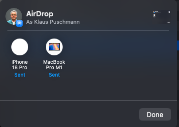</a>
</p>

<details>
<summary>More AirDrop screenshots — return directions and full desktop</summary>

**MacBook Pro → Hackintosh:** native sender confirmation.

<p>
  <a href="Assets/AWDL-Beta/Historical/AirDrop-MBP-to-Hack.png">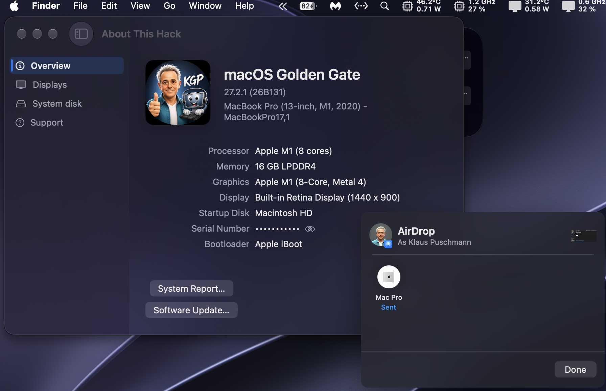</a>
</p>

**iPhone → Hackintosh:** the iPhone shows **Gesendet** (Sent).

<p>
  <a href="Assets/AWDL-Beta/Historical/AirDrop-iPhone-to-Hack.png">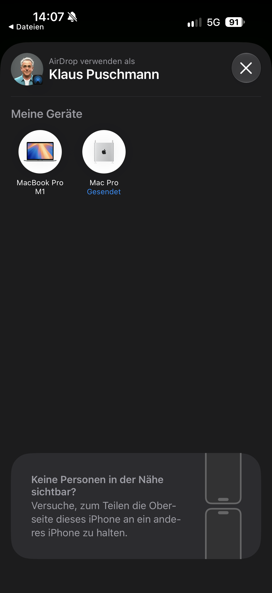</a>
</p>

**Full desktop:** the same two outgoing confirmations as the first image.

<p>
  <a href="Assets/AWDL-Beta/Historical/AirDrop-Hack-to-iPhone-and-MBP-full.png">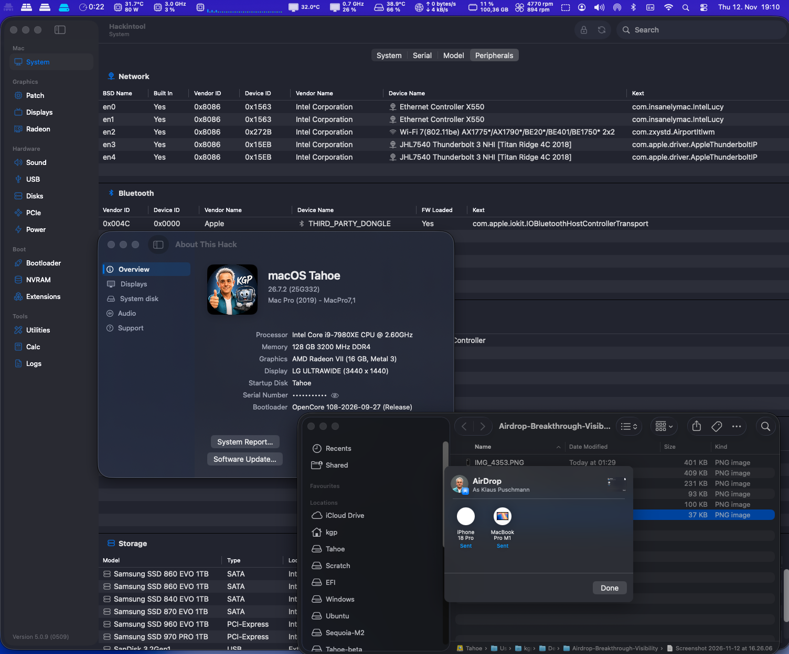</a>
</p>

</details>

<details>
<summary>Historical Personal Hotspot connection — current reliability remains limited</summary>

**iPhone 18 Pro — Connected.** The preserved R27 run also records a WLAN link
and an iPhone-issued DHCP address.

<p>
  <a href="Assets/AWDL-Beta/Historical/Hotspot-connected.png">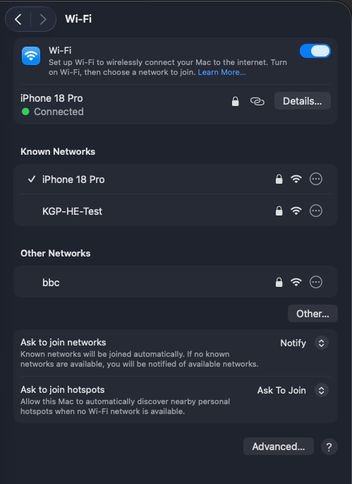</a>
</p>

**Personal Hotspot in the Wi-Fi menu.**

<p>
  <a href="Assets/AWDL-Beta/Historical/Hotspot-menu.png">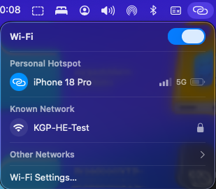</a>
</p>

**Network settings:** Wi-Fi connected; Ethernet services disconnected or inactive.

<p>
  <a href="Assets/AWDL-Beta/Historical/Hotspot-network-settings.png">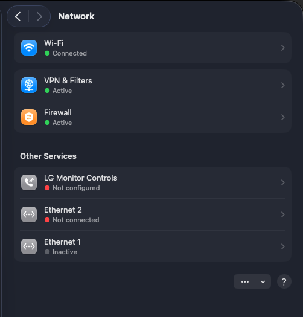</a>
</p>

**Browser session:** a loaded GitHub page during the reported Hotspot use.
This image alone does not establish the browser request's network route.

<p>
  <a href="Assets/AWDL-Beta/Historical/Hotspot-browser.png">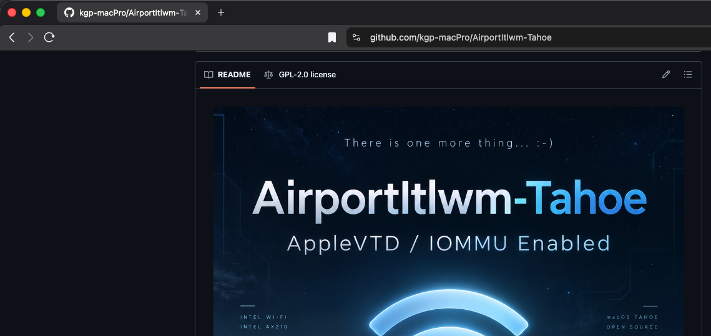</a>
</p>

</details>

### Testing and feedback

Developer contributions are very welcome. If you would like to help improve
the driver, Bluetooth integration, performance or documentation, please submit
a [pull request](https://github.com/kgp-macPro/AirportItlwm-Tahoe/pulls).

Please report the card, macOS version, loaded WLAN/Bluetooth versions, AP
channel and transfer direction. Distinguish discovery from an actual file
arrival, and note delays, failures and whether Internet access remained usable.

For AX201 and AX211 in particular, please include PCI device/subsystem IDs and
the firmware identity when available. Report the configuration actually used,
including AppleVTD/mapped status, rather than inferring it from the card name.

For a useful Wi-Fi check, turn Ethernet off on both Macs during the test.
AirDrop may still use the local Wi-Fi network through the AP; this is a valid
transport choice. Existing paired capture helpers are optional and allow
AWDL and local-Wi-Fi transfers to be distinguished.

Start with normal Wi-Fi after login, then open AirDrop and send a small file
in each direction. If that works, repeat with the same larger file to compare
setup delay and transfer time. A transfer over the existing local Wi-Fi
network is a valid AirDrop result; captures are needed when specifically
qualifying the AWDL path. Please keep failed attempts in the report as well
as successes.


---

## Credits

AirportItlwm-Tahoe builds on work by several projects and developers. The
credits below cover the regular Wi-Fi release and the experimental AirDrop
beta; beta contributions are identified explicitly.

### Driver foundations and contributed work

- **[zxystd and OpenIntelWireless](https://github.com/OpenIntelWireless/itlwm)**
  — itlwm/AirportItlwm, the Intel wireless driver foundation and the original
  Apple wireless integration. **[DexterSLamb](https://github.com/DexterSLamb)**
  — the pinned upstream fork used as this project's starting point.
- **Intel and the Linux iwlwifi/iwlmvm contributors** — firmware API
  definitions and implementations ported/adapted for MAC/PHY/LINK resources,
  AP/GO roles, stations, queues, beacons and TSF timing. The GL92 backend and
  AX GO integration depend on this work. Credit includes **Intel Corporation,
  Intel Mobile Communications GmbH and Intel Deutschland GmbH**, as named in
  the source; original SPDX and copyright notices are retained. Intel's
  firmware files remain separately licensed.
- **[gsfront](https://github.com/gsfront)** — contributed BE200 HE and optional
  HE SU-Beamformee support, firmware/link/station setup, HE information-element
  corrections and receive aggregation/reordering work through
  [PR #5](https://github.com/kgp-macPro/AirportItlwm-Tahoe/pull/5).
  Original commits, authorship and co-author notices are preserved.
- **[laobamac](https://github.com/laobamac/itlwm)** — AX HE implementation used
  as a reference and adapted to our Ventura Legacy path; native Wi-Fi and
  macOS integration sources for adaptation and comparison.
  **[crazyhulk](https://github.com/crazyhulk)** — authored the experimental
  AWDL/P2P implementation submitted as
  [laobamac PR #53](https://github.com/laobamac/itlwm/pull/53), including
  mechanisms adapted for our AX backend. Our Legacy frontend, DMA lifetimes
  and final integration remain distinct project work.
- **[mingww64](https://github.com/mingww64)** — authored
  [laobamac PR #36](https://github.com/laobamac/itlwm/pull/36), the WPA2/WPA3
  transition-mode association changes. The beta adapts the relevant scan-IE
  conversion and PSK-selection mechanisms to the Legacy driver. This credits
  the contributed WLAN change without claiming reliable Instant Hotspot.
  [PR #55](https://github.com/laobamac/itlwm/pull/55) was separately examined
  as an LQM/structure-layout reference; its WCL message path is not claimed
  as an R49 import.
- **[Bananz0](https://github.com/Bananz0), and Glen Muthoka as credited in
  the original source** —
  [AirportItlwm-Tahoe-AWDL](https://github.com/Bananz0/AirportItlwm-Tahoe-AWDL)
  host-protocol code retained and adapted for AWDL templates, frame/service
  handling, peer synchronization and channel structures; original copyright
  and GPL notices remain. Additional mechanisms from the companion
  [Tahoe BLE work](https://github.com/Bananz0/BrcmPatchRAM-Tahoe-BLE) were
  adapted into our separate modified BlueToolFixup.
- **[retropineaple](https://github.com/retropineaple)** — author of
  [ForbiddenItlwm](https://github.com/retropineaple/ForbiddenItlwm), an important
  AWDL mechanism and comparison reference. Announcement framing, service
  handling, peer timing and coexistence behavior informed adaptations and
  investigations here. The Data-Path-TLV infrastructure-omission mechanism
  was specifically adapted, with Legacy address fields retained.
  R49's Legacy frontend, fixed-channel GO role and
  BE200/AX firmware implementation are described separately in the beta
  section.
- **NorthKoreanNoodles / maddog860** — published the direct virtual-interface
  attach/publication approach, subsequently validated and adopted for this
  project's Legacy AWDL interface.
- **[Acidanthera](https://github.com/acidanthera)** — Lilu, MacKernelSDK and
  the original BlueToolFixup/BrcmPatchRAM foundation.
  **zxystd, OpenIntelWireless and
  [lshbluesky](https://github.com/lshbluesky/IntelBluetoothFirmware)** —
  IntelBluetoothFirmware and IntelBTPatcher, including the unchanged 2.5.3
  components in the tested bundle. The beta's modified BlueToolFixup and BLE
  integration combine these foundations, Bananz0's patch mechanisms and our
  native-image/controller-selection adaptations.

### Project development, testing and research

**[KGP / kgp-macPro](https://github.com/kgp-macPro) — Project lead, maintainer
and integration coordinator.** Project concept and technical goals;
continuous human direction, supervision and critical review of AI-assisted
development and reverse engineering; integration and refinement of upstream
contributions; regression investigation; software and hardware validation
across driver revisions, devices and macOS builds; and the design, execution
and analysis of reproducible benchmark campaigns.

KGP also coordinates community testing, reviews conflicting findings,
challenges assumptions and redirects investigations, maintains technical
documentation and evidence-backed handovers, and manages release preparation
and publication. Development combines AI-assisted implementation and binary
analysis with sustained human judgment, hands-on hardware testing and
repeated validation on real systems.

- **[netiave](https://github.com/netiave)** — historical AX201/CNVW testing,
  including the documented mapped/AppleVTD configuration.
  **[LuizMeliga](https://github.com/luizmeliga)** — historical AX211 testing.
  Their earlier infrastructure results are credited without implying that
  they tested the current AirDrop beta. Thanks also to the community members
  reporting reproducible successes, failures and regressions.
- **[Mieze / IntelLucy](https://github.com/Mieze/IntelLucy)** — prior art
  informing mapper-aware DMA and lifetime design; reference work, not a claim
  of copied implementation or co-development.
- **OpenBSD and the net80211/iwn/iwm/iwx contributors** — inherited wireless
  stack and Intel driver ancestry, with original per-file notices retained.
- **[seemoo-lab / Open Wireless Link](https://github.com/seemoo-lab/owl)** —
  AWDL protocol and timing research used as a reference; no OWL implementation
  code is imported into this driver.
- **OCLP contributors and
  [OCLP-CustoMac](https://github.com/kgp-macPro/OCLP-CustoMac)** — the restored
  wireless framework/root-patch environment used by this project's setup.
- **[REA](https://github.com/morluto/rea) and
  [Ghidra](https://github.com/NationalSecurityAgency/ghidra)** — binary-analysis
  tools used to investigate specific native interfaces and compiled paths.
  Their results do not substitute for firmware or hardware validation.

### AI-assisted development and human direction

- **OpenAI ChatGPT** — Collaborative analysis, technical discussion, critical review, documentation, handover preparation and release planning under KGP’s continuous direction.
- **OpenAI Codex CLI** — AI-assisted implementation, debugging, builds, automated checks, REA/Ghidra-assisted binary investigation and repository integration under KGP’s continuous supervision, review and hardware validation.

KGP directs, reviews and validates this work and controls project and release
decisions. These acknowledgements do not imply endorsement or support by
OpenAI. [Verified GitHub co-author attribution](docs/AI_ATTRIBUTION.md) is
limited to tools that actually contributed; it does not replace human
responsibility or hardware validation.

Inherited source copyrights, co-author notices and the [license](LICENSE)
remain applicable.
These acknowledgements distinguish contributed code, adapted work,
references, testing and tools; they do not imply joint maintenance or
endorsement by the named projects.
