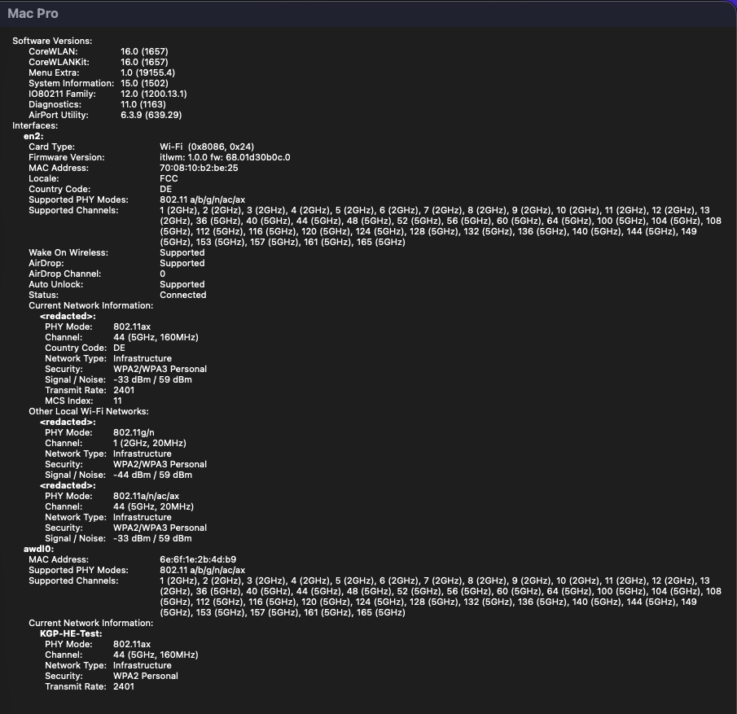
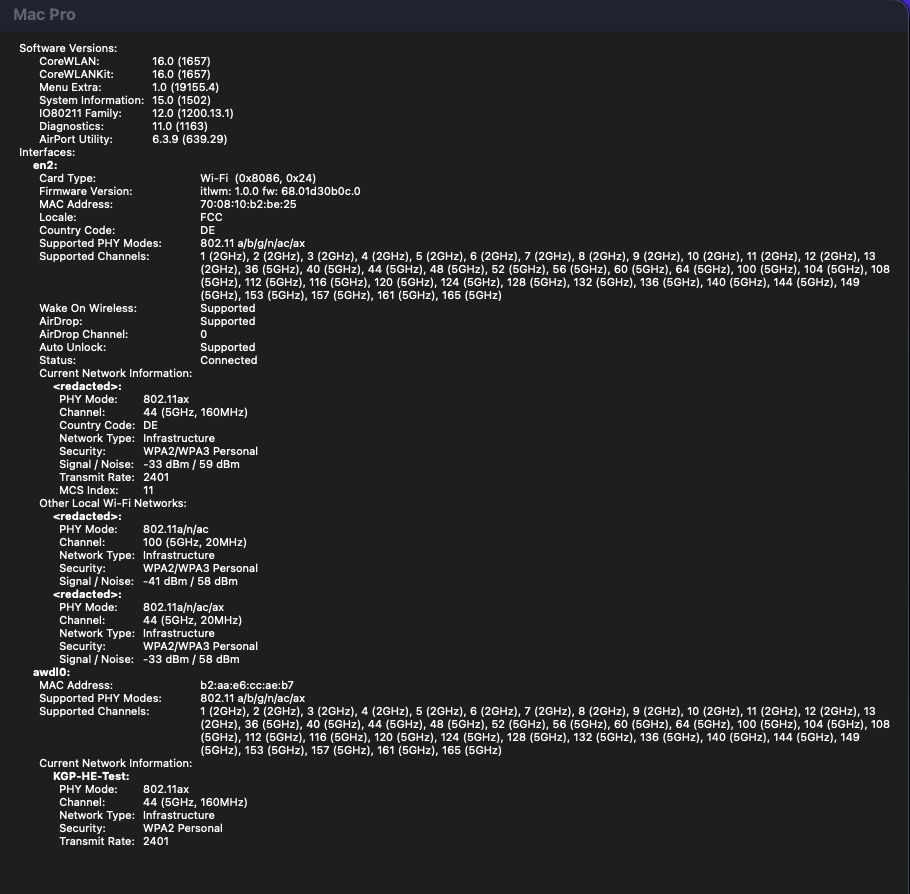
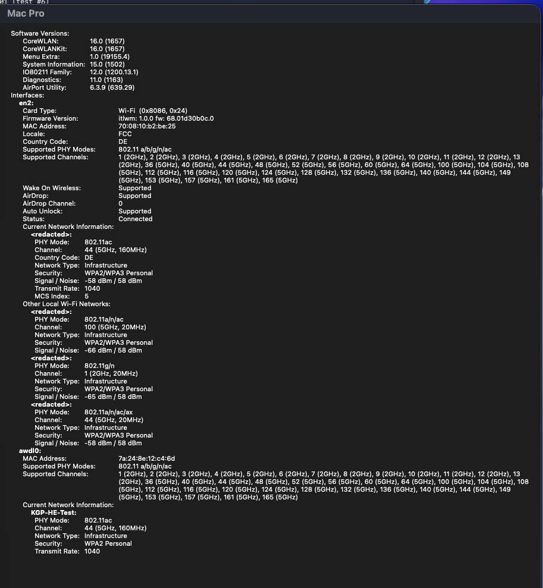
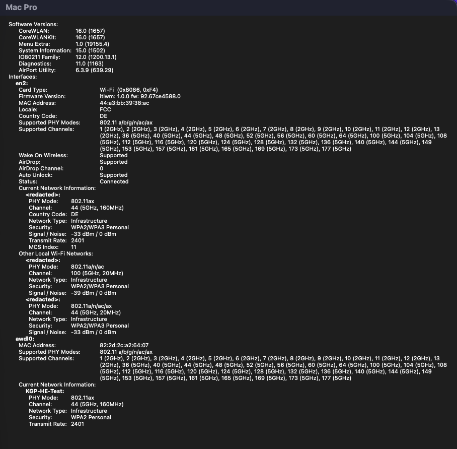
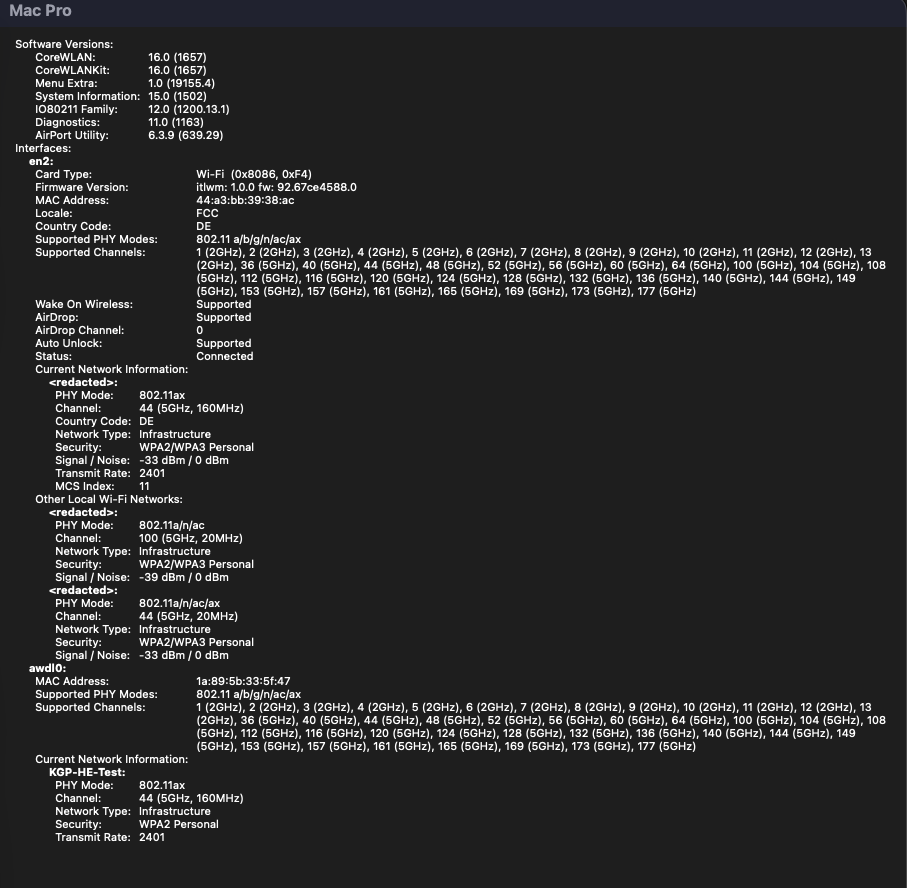
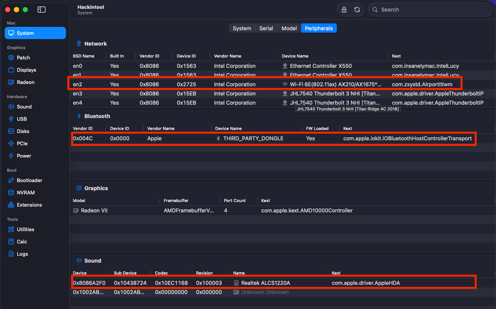
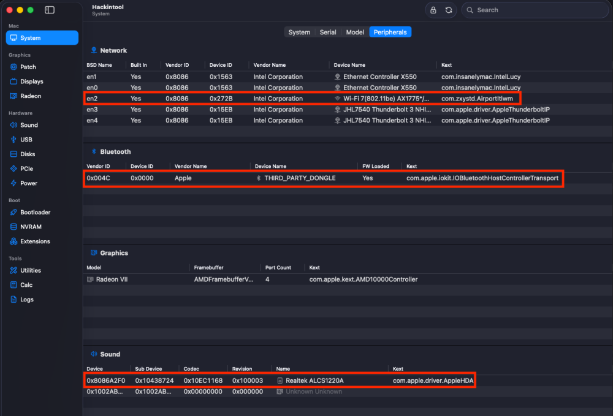

  

# AirportItlwm-Tahoe 2.0.0

**Intel Wi-Fi for macOS Tahoe with AppleVTD / IOMMU support**

**Intel BE200 · AX210 · AX201 · AX211** 
**VHT · HE · HE + BF**

Intel Wi-Fi for macOS Tahoe, with native macOS Wi-Fi integration through the
Ventura Legacy stack. The intended driver paths support DMA mapping through
the system IOMapper while keeping AppleVTD enabled in the documented setup.
Device-specific conventional paths remain supported; AppleVTD being active
and this Wi-Fi device actually using mapped DMA are separate facts.

**[Download 2.0.0](https://github.com/kgp-macPro/AirportItlwm-Tahoe/releases/download/v2.0.0/AirportItlwm-Tahoe-2.0.0.zip)** ·
[Regular Latest release](https://github.com/kgp-macPro/AirportItlwm-Tahoe/releases/latest) ·
[SHA256 checksums](https://github.com/kgp-macPro/AirportItlwm-Tahoe/releases/download/v2.0.0/SHA256SUMS.txt) ·
[Installation](INSTALL.md) · [Modes and benchmark guide](docs/benchmark/README.md)

**Required: [OCLP-CustoMac 3.0.0 or newer](https://github.com/kgp-macPro/OCLP-CustoMac/releases),
with the matching root patches for the Ventura Legacy wireless stack.**
OCLP-CustoMac supplies the Apple framework/patch environment, including the
legacy wireless dependencies; AirportItlwm-Tahoe supplies the separate Intel
driver and its device-specific DMA implementation. The kext alone does not
replace root patching. This is not a native Tahoe/Sonoma Skywalk frontend port.

## Start here

1. Read [installation and rollback](INSTALL.md), verify your OCLP-CustoMac patch
   state, and install the complete `AirportItlwm.kext` manually.
2. Choose VHT (no HE/BF opt-in), HE (`-itlwmhe`) or HE with optional SU-Beamformee
   (`-itlwmhe -itlwmbf`). Do not use `-novht` for these VHT/HE campaigns.
3. Check the loaded build, PCI-to-driver-to-interface binding and actual DMA
   mode; then use the [complete r13 benchmark package](https://github.com/kgp-macPro/AirportItlwm-Tahoe/releases/download/v2.0.0/AirportItlwm-Tahoe-Benchmark-Tools-r13.zip).
   The standard 3×20 runner is the VHT starting point; extended RX matrices
   are for HE stress comparisons. A runner's candidate path is an identity
   reference to the already loaded bundle, not an installation command.

## Device, mode and validation scope

| Device / path | VHT evidence | HE / HE+BF opt-in evidence | DMA boundary |
|---|---|---|---|
| **BE200**, PCI 8086:272B, BZ/GL92 |P10, 60 tests +online; VHT160|P10, six campaigns / 360 tests +online, including HE and BF opt-in|AppleVTD active and **mapped** verified in these campaigns|
| **AX210**, PCI 8086:2725 |Historical P10 VHT160, 60 tests +online|Final R9 HE160 /HE+BF-opt-in:180/180 tests +3 online|AppleVTD active and **mapped** verified|
| **AX201 / CNVW** |Fulvio’s 4 Nov **Alpha 2** campaigns:42/42 mapped Mode 2 and42/42 conventional Mode 1, each +online; retain their original build/setup|AX HE code present; new HE/BF hardware validation **pending**; some profiles lack required firmware 63|Both mapped and conventional configurations are supported where qualified; check the **actual runtime mode**, never infer it from AX201/CNVW naming|
| **AX211** |Historical Alpha 2/P8R1:42/42 **mapped** tests; 80 MHz per KGP, not a 160 MHz proof|AX HE code present; new HE/BF hardware validation **pending**; some profiles lack firmware 63|Use captured runtime mode; historical mapped result does not qualify a new HE build|

Fulvio’s independently checked [Alpha-2 originals from 4 November](docs/AX201_DMA.md#alpha-2-evidence-from-4-november-2026) confirm mapped Mode 2; these are historical results, not new 2.0.0 tests.
His mapped results supersede the old “AX201/CNVW conventional only” guidance.
Use the [AX201 r13 commands](docs/benchmark/README.md#ax201cnvw-mapped-and-conventional-comparisons):
`AX201-2.0.0` with `EXPECTED_MODE=mapped` for his mapped configuration, or a
separate conventional comparison. `EXPECTED_MODE` **checks**, and never switches,
the driver’s DMA route. See [evidence and correction history](docs/AX201_DMA.md).

2.0.0 is a versioned rebuild of the final tested R9 implementation. Campaigns
retain their original **P10** or **R9** binary UUID/hash; the release binary has
its own identity and was not put through an additional hardware campaign just
for version numbering. See [build identity and provenance](docs/BUILD.md),
[exact code scope](docs/TECHNICAL_LINEAGE.md) and [all results](docs/results/2.0.0.md).
A retail label or shared profile name is not device or hardware-validation proof.

### Planned development: BE200 Wi-Fi 7

BE200 Wi-Fi 7 (802.11be/EHT) support is planned for a future release. We intend to complete implementation and hardware validation once a FRITZ!Repeater 6700 Pro is available for our test setup.

Wi-Fi 7 is not included in version 2.0.0. The final feature scope and release timing will depend on successful implementation and hardware testing.

The planned test hardware is a prerequisite, not a promise of immediate
completion. No EHT/MLO/6 GHz/320 MHz support is claimed in 2.0.0 from the BE200
name or the AP's marketing capabilities.

## What changed

- gsfront's [original PR #5](https://github.com/kgp-macPro/AirportItlwm-Tahoe/pull/5) is regularly merged into its original
  `be200-alpha` base, preserving both commits and authorship. BE200 HE/BF,
  HE capabilities, link/station setup, frame release and the earlier 256-entry
  HE RX BA/reordering support are retained.
- The AX201/AX210/AX211 HE path is adapted from pinned
  [laobamac 7204c69](https://github.com/laobamac/itlwm/tree/7204c69d1bfa7f5cc0f7864e08fb03e55d0ec29e)
  for our existing Legacy frontend, NVM/firmware gates and AX command formats.
- **Firmware rate reporting:** AX HE and HE+BF use the newest coherent
  TLC/BA feedback tuple for rate, MCS, NSS, width and GI. This is firmware
  reporting, not a PHY measurement of every packet. Idle last-known values
  have separate age/freshness diagnostics; no fixed 2401/MCS11 is forced.
- **Earlier AX-HE packet handoff:** mapped non-BZ HE RX publishes safely
  replaced-buffer credits and delivers after 32 completions or at least 64
  ready packets, at a completion boundary. Larger atomic releases remain
  intact. This is separate from the **already existing 256-entry BA window**.
  VHT and conventional RX do not execute this budget. BE200 already has its
  own 32-completion service and is not given AX commands or a duplicate fix.

## Required wired-peer link modes

| Wi-Fi test mode | Required wired peer link for comparable campaigns |
|---|---|
| VHT | **1000Base-T / 1 Gbit/s** |
| HE | **2500Base-T / 2.5 Gbit/s** |
| HE + BF opt-in | **2500Base-T / 2.5 Gbit/s** |

**Do not use 5000Base-T or 10GBase-T for these comparison campaigns.** The OWC
adapter supports 10 GbE but must be limited to the appropriate mode. Verify and
record the *negotiated* media on the wired peer. These are this project's
comparison-method conditions, not general IEEE requirements for HE.

## AX210: complete R9 campaigns

Receiver throughput, Mbit/s, arithmetic mean of three rounds. Each campaign
completed 60 iperf3 tests and its final Internet test. In 288 recorded TCP sum
intervals there were no complete zero intervals. Remaining retries and loss
are retained below and in the detail data.

| Recorded campaign | Mode / UDP matrix | TX P1 | TX P4 | RX P1 | RX P4 |
|---|---|---:|---:|---:|---:|
| `AX210-P10R9_AX210_3X20_TX600_RX1300` | HE / RX1300 | 697.7 | 689.4 | 1668.2 | 1876.6 |
| `AX210-P10R9_AX210_3X20_TX600_RX1700` | HE / RX1700 | 697.2 | 687.4 | 1700.3 | 1861.9 |
| `AX210-P10R9_AX210_3X20_TX600_RX1700` | HE+BF opt-in / RX1700 | 696.9 | 688.4 | 1693.3 | 1887.6 |

AX210 HE160 screenshot

[Open original resolution](Assets/2.0.0/AX210-HE.png)

Original HE screenshot. It has no UUID and is not by itself proof of the R9 build. The table is pinned by the archives, not the image. Historical internal 1.0.0 text is intentionally unchanged.

AX210 HE160 with BF opt-in: 2401 Mbit/s and MCS11

[Open original resolution](Assets/2.0.0/AX210-HE-BF.png)

AX210 HE160 with optional HE SU-Beamformee support, hardware-tested with the opt-in enabled. KGP confirmed both boot arguments; the screenshot alone does not prove on-air beamforming or its performance effect.

**Residuals:** TCP P4 retransmits remain. Completion of a UDP stress test does
not mean loss-free operation. HE-only RX1700 reported about 35% loss in all
three rounds; RX1500 had one 20.4% run, and the UDP1300 campaign included a
35.2% RX1000 spike. Under BF opt-in every RX stage through 1500 reported 0%
in all rounds; RX1700 was about 34%, 35%, 0%, with about 1705 Mbit/s received in
the last round. All other spikes and UDP TX losses are in the
[per-round detail](docs/results/2.0.0.md). These runs do not isolate BF effect.

The successful R9 short control probe completed at 1195 Mbit/s UDP reception;
its result-request ACK took 0.167 ms versus 9.952 s in the failed R8 probe.
A later server 117/9 teardown after completed result exchange is documented
separately. Additional manual P1 observations were about 1.71 Gbit/s RX and
698 Mbit/s receiver TX, without retransmits; they are not pooled into the tables.

### Historical AX210 P10 VHT, not an R9 VHT test

| Recorded campaign | Mode / UDP matrix | TX P1 | TX P4 | RX P1 | RX P4 |
|---|---|---:|---:|---:|---:|
| `AX210-P10_AX210_3X20` | VHT / RX900 | 387.6 | 440.4 | 854.5 | 896.3 |

Historical AX210 P10 VHT160 screenshot

[Open original resolution](Assets/2.0.0/AX210-VHT.png)

Historical P10 with HE/BF off: 802.11ac, channel 44/160 MHz. No R9-VHT hardware claim is derived from it.

## BE200: VHT, HE and HE+BF already tested

Seven P10 archives: 420/420 tests and seven final online tests; 382 manifest
checks per archive. These pin the original P10 binary, not the new release
UUID. Different standard/stress matrices and early versus later testbed
conditions are displayed separately, not pooled or treated as a BF A/B test.

| Recorded campaign | Mode / UDP matrix | TX P1 | TX P4 | RX P1 | RX P4 |
|---|---|---:|---:|---:|---:|
| `BE200-P10_BE200_3X20` | VHT / RX900 | 633.2 | 587.4 | 914.0 | 922.2 |
| `BE200-P10_BE200_3X20` | HE / RX900 | 362.4 | 436.5 | 931.7 | 931.8 |
| `BE200-P10_BE200_3X20` | HE+BF opt-in / RX900 | 312.0 | 431.9 | 934.5 | 933.5 |
| `BE200-P10_BE200_3X20` | HE+BF opt-in / RX900 | 699.4 | 677.6 | 1688.0 | 1867.8 |
| `BE200-P10_BE200_3X20_TX600_RX1700` | HE+BF opt-in / RX1700 | 696.9 | 678.7 | 1702.0 | 1883.7 |
| `BE200-P10_BE200_3X20_TX600_RX1700` | HE / RX1700 | 694.2 | 681.3 | 1684.3 | 1858.1 |
| `BE200-P10_BE200_3X20_TX600_RX1600` | HE / RX1600 | 697.5 | 679.4 | 1660.8 | 1825.4 |

The VHT campaign exists; its screenshot is missing. No replacement image or
additional test was created. Its saved `ItlwmHeLink=not-he` supports the KGP
VHT assignment; absent HE setup properties alone are not boot-argument proof.
The HE/BF provider properties distinguish the six HE campaigns.

BE200 P10 HE160 screenshot

[Open original resolution](Assets/2.0.0/BE200-HE.png)

Original tested P10 context, firmware 92.67ce4588.0. The displayed PHY rate is not payload goodput or proof of the new release UUID.

BE200 P10 HE160 with beamformee opt-in screenshot

[Open original resolution](Assets/2.0.0/BE200-HE-BF.png)

Original P10 HE+BF-opt-in context; retained unchanged. See the [tested Bluetooth configuration](#tested-bluetooth-configuration) used with this setup.

## Reference system and network

| Component | KGP's documented setup |
|---|---|
| Main system |ASUS WS X299 Sage/10G; Intel Core i9-7980XE ; 128 GB RAM; AMD Radeon VII; SMBIOS MacPro7,1|
| Existing Ethernet |Intel X550-AT2 with IntelLucy|
| IOMMU |AppleVTD enabled; these BE200/AX210 campaigns captured actual mapped mode|
| OS in campaign preflights |macOS Tahoe 26.7.2 / 25G332; not a KDK version or a claim about every installed OS|
| Router / switch |FRITZ!Box 7590; MikroTik CRS309 with S+RJ10|
| Wi-Fi AP |Mercusys MR27BE in AP mode; 5 GHz, channel 44, 160 MHz, WPA2/WPA3 Personal|
| Wired peer |MacBook Pro 13-inch M1 (2020), OWC 10 GbE adapter, manually limited as above|
| Tools |iperf 3.22, cJSON 1.7.15 as captured/reported|
| Internet service |80 Mbit/s down / 30 Mbit/s up; limits Internet networkQuality, not local iperf3|

Our AX210 address/interface were `en2 / 192.168.178.135`; the MBP server was
`192.168.178.197:5201`. Public commands below use the tester's own interface/IP.
Historical client archives do not independently measure the peer's physical
link; record it explicitly for new comparisons rather than retroactively
inferring it from throughput or the adapter's 10 GbE capability.

We recommend the inexpensive [Mercusys MR27BE](https://www.mercusys.com/de/product/wifi-router/mr27be/)
as an interim AP for reproducing this setup while a later network upgrade is
planned: roughly €50–55 before retailer/shipping differences (for example,
[a retailer listing](https://www.alza.de/mercusys-mr27be-levne-d12786466.htm)).
Check current total price; no future FRITZ!Repeater availability date is asserted.
The AP's Wi-Fi 7 marketing is not a driver capability claim.

AX210 PCI 8086:2725 hardware binding

[Open original resolution](Assets/2.0.0/AX210-Hackintool.png)

The PCI 8086:2725 identity and loaded AirportItlwm binding take precedence over generic model strings. The Bluetooth line is not physical-chip identification; see the [tested Bluetooth configuration](#tested-bluetooth-configuration).

BE200 PCI 8086:272B hardware binding

[Open original resolution](Assets/2.0.0/BE200-Hackintool.png)

PCI 8086:272B is the BE200 reference. Hackintool may show a generic Wi-Fi 7/AX model label; this is not evidence for EHT in this release. See the separate [tested Bluetooth configuration](#tested-bluetooth-configuration).

## Tested Bluetooth configuration

| Loaded kext in the BE200-P10 and AX210-R9 preflights | Version | Exact source |
|---|---|---|
| IntelBluetoothFirmware.kext |2.5.1|[lshbluesky v2.5.1](https://github.com/lshbluesky/IntelBluetoothFirmware/releases/tag/v2.5.1)|
| IntelBTPatcher.kext |2.5.1|[lshbluesky v2.5.1](https://github.com/lshbluesky/IntelBluetoothFirmware/releases/tag/v2.5.1)|
| BlueToolFixup.kext |2.7.2|[Acidanthera/BrcmPatchRAM 2.7.2](https://github.com/acidanthera/BrcmPatchRAM/releases/tag/2.7.2)|

These are separate Bluetooth components, not bundled AirportItlwm features.
Follow their own dependencies and instructions. Hackintool's
“Apple / THIRD_PARTY_DONGLE / 0x004C” does not identify the physical Bluetooth
chip. The separate Bananz0 BLE/AWDL analysis is not integrated into2.0.0.

## AI-assisted development and human direction

- **OpenAI ChatGPT** — Collaborative analysis, technical discussion, critical review, documentation, handover preparation and release planning under KGP’s continuous direction.
- **OpenAI Codex CLI** — AI-assisted implementation, debugging, builds, automated checks, REA/Ghidra-assisted binary investigation and repository integration under KGP’s continuous supervision, review and hardware validation.

KGP directs, reviews and validates this work. The [full approved KGP credit and all developer, tester and tool acknowledgements](CREDITS.md) are retained. These acknowledgements do not imply endorsement or support by OpenAI. [Verified GitHub co-author attribution](docs/AI_ATTRIBUTION.md) is limited to tools that actually contributed; it does not replace human responsibility or hardware validation.

## Limits and historical records

AX201/AX211 HE/BF hardware validation, some firmware 63 profiles, longer-load/
Sleep-Wake qualification, remaining loss/retry attribution and actual BF-use
proof remain open. Little Snitch and Avast were active according to KGP;
BE200 and AX210-VHT also work with them. No general filter/environment cause
is established. No extra RF capture or hardware campaign was required for 2.0.0.

No new AirDrop/AWDL/BLE functionality is included. A published interface or a
“Supported” label is not a completed AirDrop transfer. Separate experimental
AWDL/BLE work was not merged. [Historical releases, qualification and downloads](docs/HISTORY.md)
remain available, including 1.0.0, 1.1.0 Beta, 1.2.0 Alpha and the old 3×14 runner.

[Credits and attribution](CREDITS.md) · [Technical lineage](docs/TECHNICAL_LINEAGE.md) ·
[Build and identity](docs/BUILD.md) · [License](LICENSE)
