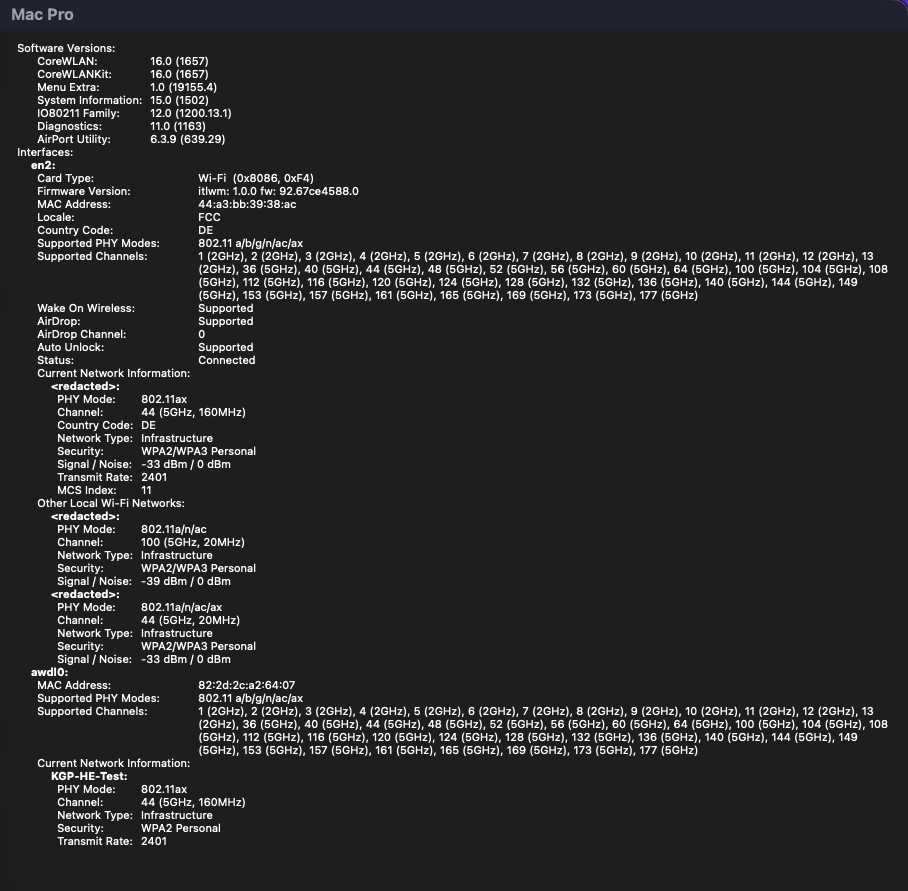
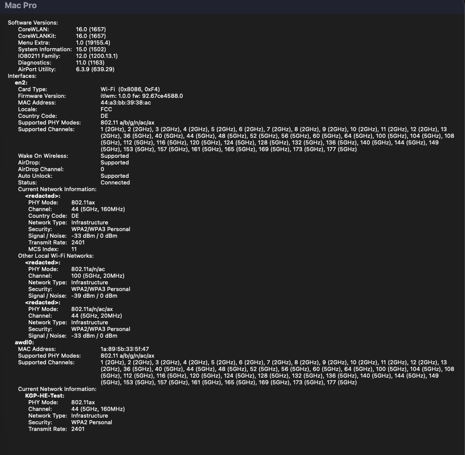

# AirportItlwm-Tahoe 2.0.0

**Intel Wi-Fi for macOS Tahoe with AppleVTD / IOMMU support.** BE200, AX210, AX201 and AX211; VHT, HE and optional HE + BF through the Ventura Legacy stack.

[Download the complete kext](https://github.com/kgp-macPro/AirportItlwm-Tahoe/releases/download/v2.0.0/AirportItlwm-Tahoe-2.0.0.zip) · [Installation and rollback](https://github.com/kgp-macPro/AirportItlwm-Tahoe/blob/main/INSTALL.md) · [Test guide](https://github.com/kgp-macPro/AirportItlwm-Tahoe/blob/main/docs/benchmark/README.md) · [SHA256SUMS](https://github.com/kgp-macPro/AirportItlwm-Tahoe/releases/download/v2.0.0/SHA256SUMS.txt)

**Requires [OCLP-CustoMac 3.0.0+](https://github.com/kgp-macPro/OCLP-CustoMac/releases) and matching Ventura Legacy wireless root patches.** OCLP supplies the framework/patch environment; this separate Intel driver supplies device-specific DMA handling. BE200 and AX210 campaigns verified AppleVTD enabled and mapped DMA. AX201/CNVW remains conventional even with AppleVTD enabled. AX211 has older mapped VHT evidence; the new AX201/AX211 HE/BF code still needs hardware validation, and some firmware-63-dependent profiles remain unavailable.

## Included changes

- gsfront's original [PR #5](https://github.com/kgp-macPro/AirportItlwm-Tahoe/pull/5) is merged with both commits and authorship preserved: BE200 HE and HE SU-Beamformee opt-in, associated station/link setup and earlier HE 256-entry RX BA/reordering support.
- AX HE adapted from laobamac's pinned [v2.4.0-alpha / 7204c69](https://github.com/laobamac/itlwm/tree/7204c69d1bfa7f5cc0f7864e08fb03e55d0ec29e), retaining our Ventura Legacy frontend and AX firmware formats.
- Corrected AX HE firmware-rate reporting: coherent rate/MCS/NSS/width/GI from current-lifetime TLC/BA feedback, including last-known age/freshness diagnostics. The same path covers HE with BF opt-in. Firmware feedback is not a per-packet PHY measurement, and no fixed MCS11/2401 values are forced.
- Bounded **mapped AX-HE** RX service with earlier ready-packet handoff after 32 completions or 64 ready packets, safe credit publication and callback lifetime checks. Larger atomic reorder releases stay intact. This is not a VHT-wide fix or a new BA-window increase: 256-entry HE BA support already existed. BE200 keeps its own bounded BZ/GL92 service and firmware/reporting path.

See [technical scope and lineage](https://github.com/kgp-macPro/AirportItlwm-Tahoe/blob/main/docs/TECHNICAL_LINEAGE.md).

## Modes and comparable testing

| Mode | Boot arguments | Required wired second-Mac link for these campaigns |
|---|---|---|
| VHT | No HE/BF opt-in | **1000Base-T / 1 Gbit/s** |
| HE | `-itlwmhe` | **2500Base-T / 2.5 Gbit/s** |
| HE + SU-Beamformee opt-in | `-itlwmhe -itlwmbf` | **2500Base-T / 2.5 Gbit/s** |

No `-novht` for these campaigns. **Do not use 5000Base-T or 10GBase-T** for the comparison methodology, even with a 10-GbE-capable adapter. Record the actual negotiated peer link. These are comparison conditions, not general IEEE requirements. LAN iperf3 is separate from the final Internet test, which was limited by KGP's 80/30-Mbit/s Internet connection.

## Measured results and remaining limits

AX210 R9, receiver means across three rounds, Mbit/s:

| Campaign | TX P1 | TX P4 | RX P1 | RX P4 |
|---|---:|---:|---:|---:|
| HE / UDP1300 | 697.7 | 689.4 | 1668.2 | 1876.6 |
| HE / UDP1700 | 697.2 | 687.4 | 1700.3 | 1861.9 |
| HE + BF opt-in / UDP1700 | 696.9 | 688.4 | 1693.3 | 1887.6 |

All **180/180** tests plus three online tests completed; no complete zero intervals in 288 recorded TCP sum intervals. Seven original BE200 P10 campaigns cover VHT, HE and BF opt-in: **420/420** tests plus seven online tests. Standard and stress matrices remain separate in the [full tables and residuals](https://github.com/kgp-macPro/AirportItlwm-Tahoe/blob/main/docs/results/2.0.0.md); older AX210 P10-VHT is separately identified.

TCP-P4 retransmits remain, and complete UDP stress tests are not necessarily loss-free. HE-only RX1700 reported about 35% loss in all rounds, with other HE-only spikes retained. BF-opt-in RX through 1500 reported 0% in all rounds; RX1700 reported about 34%, 35% and 0% (last receiver about 1705 Mbit/s). UDP-TX sender ceilings/loss and all per-round retries remain in the data. There is no universal stability or BF-performance claim.

**AX210 HE160 with optional HE SU-Beamformee support, hardware-tested with the opt-in enabled.** Confirmed boot arguments, screenshots and throughput do not alone prove on-air sounding/feedback or BF gain. AX201/AX211 HE/BF remains hardware-unvalidated. No new Wi-Fi 7/EHT, MLO, 6-GHz, 320-MHz or AirDrop/AWDL/BLE functionality is included. Planned BE200 Wi-Fi 7 work is a future project, dependent on implementation and hardware testing, not this release.

## BE200 — P10 hardware results: VHT, HE and HE with BF opt-in

**Seven complete original P10 campaigns: 420/420 local iperf3 tests plus seven successful Internet-test completions.** Each campaign is three rounds of 20 tests. All seven original manifests passed (382 files per archive). The captured identity boundaries match P10 and the actual DMA diagnostics report **mapped mode with AppleVTD enabled**.

### Main TCP comparisons

Receiver throughput in Mbit/s, arithmetic mean of all three rounds; TX/RX are from the tested Wi-Fi client's perspective. These rows use exactly the archives identified below, without pooling different matrices or selecting best rounds.

| BE200 mode / campaign | TCP TX P1 | TCP TX P4 | TCP RX P1 | TCP RX P4 |
|---|---:|---:|---:|---:|
|VHT / standard RX900|633.2|587.4|914.0|922.2|
|HE / TX600–RX1700|694.2|681.3|1684.3|1858.1|
|HE + BF opt-in / TX600–RX1700|696.9|678.7|1702.0|1883.7|

Archive mapping for these three rows:

- **VHT:** `BE200-P10_BE200_3X20_mapped_20261104_234618_Th4JI5.zip`.
- **HE:** `BE200-P10_BE200_3X20_TX600_RX1700_mapped_20261105_013222_0lIH0l.zip`.
- **HE+BF opt-in:** `BE200-P10_BE200_3X20_TX600_RX1700_mapped_20261105_011314_OSq3w9.zip`.

### Other complete campaigns, kept separate

These are additional standard repetitions or a different RX stress matrix, not extra rounds of the three rows above. Earlier and later testbed conditions were not a controlled BF on/off comparison.

| Archive timestamp / suffix | Mode / UDP matrix | TX P1 | TX P4 | RX P1 | RX P4 |
|---|---|---:|---:|---:|---:|
|`20261105_000828_UVz8gn`|HE / RX900|362.4|436.5|931.7|931.8|
|`20261105_003136_jGbcco`|HE+BF opt-in / RX900|312.0|431.9|934.5|933.5|
|`20261105_004905_2CcSY7`|HE+BF opt-in / RX900|699.4|677.6|1688.0|1867.8|
|`20261105_014909_mgPRwL`|HE / RX1600|697.5|679.4|1660.8|1825.4|

### Retransmits, UDP stress and remaining limits

TCP P4 retransmits remain; nonzero P1 retransmits also occur in some rounds. The per-campaign tables below retain the sender's exact TCP counts. MAC/firmware retries are a different metric. All listed tests completed, but this does not mean every UDP load was loss-free.

- **VHT / standard:** RX100–700 and RX900 reported 0% in all rounds; RX800 round 3 reported 0.0932%. TX800 round 3 reported 1.9602%. Offered TX700–900 was often sender-limited to roughly 600 Mbit/s with high local iperf CPU, so these are not achieved 700–900-Mbit/s transmissions.
- **HE / RX1700:** the highest RX stage reported **27.329%, 27.062%, 30.914%** loss. RX1100 round 2 and RX1300 round 3 also had small loss; all other nonzero TX/RX values remain below.
- **HE + BF opt-in / RX1700:** RX1700 reported **9.141%, 0.366%, 0.000%**, with receiver rates approximately **1534.9, 1698.7, 1705.0 Mbit/s**. One repeated TX600 stage in round 2 reported about 0.956% loss.
- **HE / RX1600:** RX1500 round 1 reported **17.134%**, RX1600 round 2 **0.423%**; one TX600 stage in round 2 reported **1.459%**. Standard HE and BF repetitions have their own smaller loss spikes, fully retained below.

These differences do not independently prove an on-air BF benefit or universal stability. Extended matrices use TX targets 300, 500, then six 600-Mbit/s cases; RX1600/1700 uses 300, 500, 700, 900, 1100, 1300, 1500 and the final ceiling. Standard runs use 100, 250, 400, 500, 600, 700, 800, 900 in both directions. TCP lasts 8 s per case; UDP 5 s with 1200-byte payloads, with 2-s gaps.

### BE200 testbed, link conditions and provenance

KGP's ASUS WS X299 Sage/10G / Core i9-7980XE system (MacPro7,1; 128 GB RAM, Radeon VII) used macOS **26.7.2 / 25G332** as captured in these preflights, the Ventura Legacy stack and AppleVTD, with **mapped DMA independently captured**. The AP was the Mercusys MR27BE in AP mode, 5 GHz, channel 44 / 160 MHz; the documented setup uses WPA2/WPA3 Personal. The wired peer was a MacBook Pro 13-inch M1 (2020) with the OWC Ethernet adapter. The wider setup includes FRITZ!Box 7590, MikroTik CRS309 / S+RJ10 and Intel X550-AT2 / IntelLucy. iperf 3.22 was used; Bluetooth is the separately listed configuration below.

**Mandatory comparison methodology:** VHT uses **1000Base-T / 1 Gbit/s** at the wired peer; HE and HE+BF use **2500Base-T / 2.5 Gbit/s**. Do not use 5000Base-T or 10GBase-T for these campaigns, despite the adapter's capability. Verify the actual negotiated wired media. These are project comparison conditions, not general IEEE HE requirements.

The historical BE200 client archives themselves **do not record the peer's negotiated Ethernet media per campaign**. No independent per-archive speed proof was supplied for these seven files, so an exact 1-/2.5-Gbit/s assignment must not be inferred from throughput or retroactively imposed. In particular, the early standard HE/BF runs and later higher-throughput repetitions are kept separate. The explicitly confirmed 2.5-Gbit/s AX210 R9 condition is not automatically transferred to each older BE200 archive.

These measurements validate the original **BE200 P10** bundle: UUID `2613EF21-BC57-3685-B252-AC94CFF4928B`, executable SHA-256 `eff556fb4846a7651bff02d0c6e38479c0d1d1493aaa8de958b6f6bbd336a270`. The final release retains that tested BZ/GL92 behavior, while guarded AX corrections and release version metadata have their own provenance. The 2.0.0 executable has a new UUID/hash; these campaigns are not re-labeled as hardware tests of the new binary. [Code scope and lineage](https://github.com/kgp-macPro/AirportItlwm-Tahoe/blob/v2.0.0/docs/TECHNICAL_LINEAGE.md) · [Full campaign index / original ZIP hashes](https://github.com/kgp-macPro/AirportItlwm-Tahoe/blob/v2.0.0/docs/results/2.0.0-campaigns.json).

BE200 P10 HE screenshot — open original resolution

[Original image](https://github.com/kgp-macPro/AirportItlwm-Tahoe/blob/v2.0.0/Assets/2.0.0/BE200-HE.png)

Original P10 HE context, firmware 92.67ce4588.0. Displayed PHY rate is not payload throughput and the image alone does not identify the later release binary or an exact campaign timestamp. [Separate tested Bluetooth configuration](https://github.com/kgp-macPro/AirportItlwm-Tahoe/blob/v2.0.0/README.md#tested-bluetooth-configuration).

BE200 P10 HE with BF opt-in screenshot — open original resolution

[Original image](https://github.com/kgp-macPro/AirportItlwm-Tahoe/blob/v2.0.0/Assets/2.0.0/BE200-HE-BF.png)

Original P10 HE+BF-opt-in context, retained unchanged. The mode/provider evidence and opt-in are not an independent proof of on-air sounding/feedback or a causal BF performance gain. [Separate Bluetooth setup](https://github.com/kgp-macPro/AirportItlwm-Tahoe/blob/v2.0.0/README.md#tested-bluetooth-configuration). The VHT campaign exists, but its screenshot is missing; no replacement was invented.

### Internet test — separate from local iperf3

Each campaign ended with a successful `networkQuality` test on en2. The following values are the raw JSON's download/upload throughput divided by 1,000,000, not local Wi-Fi-to-Ethernet capacity. KGP's nominal Internet service is reported as 80/30 Mbit/s; observed tool values are retained as measured rather than forced to that nominal figure.

| BE200 campaign | Internet download Mbit/s | Internet upload Mbit/s | Completion |
|---|---:|---:|---|
|BE200_VHT|75.82|37.52|PASS|
|BE200_HE_STANDARD|73.90|40.44|PASS|
|BE200_BF_STANDARD_1|75.62|39.47|PASS|
|BE200_BF_STANDARD_2|71.36|40.03|PASS|
|BE200_BF_UDP1700|71.04|35.35|PASS|
|BE200_HE_UDP1700|74.91|31.91|PASS|
|BE200_HE_UDP1600|70.29|34.89|PASS|

### All seven campaigns: per-round TCP and UDP data

VHT / standard RX900 — 20261104_234618_Th4JI5: all rounds, retries and UDP loss

Original archive: `BE200-P10_BE200_3X20_mapped_20261104_234618_Th4JI5.zip` 
SHA-256: `e2072a3ea45158963f3107d2852fb8c8c6d150b7d6e63c2c5e5a498265cbe638`

`COMPLETE_60_AND_ONLINE`, exit 0: **60/60 tests + one successful online test; 382 manifest checks**. Protocol `AIRPORTITLWM_3X20_NO_PROFILER_V1`.

| TCP case | Receiver round 1 | Round 2 | Round 3 (Mbit/s) | Sender TCP retransmits, rounds 1 / 2 / 3 |
|---|---:|---:|---:|---|
|TCP_TX_P1|630.813|632.557|636.344|33 / 53 / 29|
|TCP_TX_P4|589.719|583.251|589.340|3600 / 2196 / 1611|
|TCP_RX_P1|919.678|901.670|920.536|0 / 463 / 0|
|TCP_RX_P4|923.678|918.413|924.634|0 / 0 / 0|

UDP target is the case name, not an achieved sender rate. Values below keep **sender / receiver / reported loss** separate; each cell lists rounds 1 / 2 / 3. Repeated TX600 cases retain their distinct test index.

| UDP test / offered target | Actual sender Mbit/s, r1 / r2 / r3 | Actual receiver Mbit/s, r1 / r2 / r3 | Reported loss %, r1 / r2 / r3 |
|---|---|---|---|
|5 UDP_TX100|100.00 / 100.00 / 100.00|99.66 / 99.66 / 99.65|0.000000 / 0.000000 / 0.000000|
|6 UDP_RX100|100.00 / 100.00 / 100.00|100.31 / 100.31 / 100.31|0.000000 / 0.000000 / 0.000000|
|7 UDP_TX250|250.00 / 250.00 / 250.00|249.14 / 249.14 / 249.12|0.000000 / 0.000000 / 0.000000|
|8 UDP_RX250|250.00 / 250.00 / 250.00|250.76 / 250.77 / 250.77|0.000000 / 0.000000 / 0.000000|
|9 UDP_TX400|400.00 / 400.00 / 400.00|398.61 / 398.18 / 398.62|0.000000 / 0.000000 / 0.001920|
|10 UDP_RX400|400.00 / 400.00 / 400.00|401.27 / 401.22 / 401.21|0.000000 / 0.000000 / 0.000000|
|11 UDP_TX500|500.00 / 500.00 / 500.00|498.24 / 498.27 / 498.25|0.000000 / 0.000000 / 0.000000|
|12 UDP_RX500|500.00 / 500.00 / 500.00|501.53 / 501.56 / 501.56|0.000000 / 0.000000 / 0.000000|
|13 UDP_TX600|597.04 / 599.68 / 596.59|589.35 / 589.95 / 589.08|0.014793 / 0.014087 / 0.027664|
|14 UDP_RX600|600.00 / 600.00 / 600.00|601.93 / 601.80 / 601.78|0.000000 / 0.000000 / 0.000000|
|15 UDP_TX700|602.29 / 603.24 / 603.10|593.25 / 593.32 / 593.21|0.057986 / 0.048677 / 0.056337|
|16 UDP_RX700|700.00 / 700.00 / 700.00|702.25 / 702.18 / 702.22|0.000000 / 0.000000 / 0.000000|
|17 UDP_TX800|600.47 / 596.46 / 614.73|593.83 / 588.93 / 593.67|0.051769 / 0.051493 / 1.960178|
|18 UDP_RX800|800.00 / 800.00 / 800.00|802.60 / 802.44 / 801.73|0.000000 / 0.000000 / 0.093229|
|19 UDP_TX900|605.10 / 600.55 / 601.71|595.11 / 592.57 / 590.99|0.052640 / 0.053709 / 0.053921|
|20 UDP_RX900|900.00 / 900.00 / 900.00|902.84 / 902.87 / 902.90|0.000000 / 0.000000 / 0.000000|

HE / standard RX900 — 20261105_000828_UVz8gn: all rounds, retries and UDP loss

Original archive: `BE200-P10_BE200_3X20_mapped_20261105_000828_UVz8gn.zip` 
SHA-256: `857173a9f12c002029ff08f677bd7ef4af3e52e6b6a9cef9840c4a5828bcc189`

`COMPLETE_60_AND_ONLINE`, exit 0: **60/60 tests + one successful online test; 382 manifest checks**. Protocol `AIRPORTITLWM_3X20_NO_PROFILER_V1`.

| TCP case | Receiver round 1 | Round 2 | Round 3 (Mbit/s) | Sender TCP retransmits, rounds 1 / 2 / 3 |
|---|---:|---:|---:|---|
|TCP_TX_P1|353.945|363.209|369.977|485 / 533 / 704|
|TCP_TX_P4|423.614|429.874|456.090|4299 / 4581 / 4520|
|TCP_RX_P1|935.704|920.233|939.242|0 / 549 / 0|
|TCP_RX_P4|930.955|932.697|931.784|0 / 0 / 0|

UDP target is the case name, not an achieved sender rate. Values below keep **sender / receiver / reported loss** separate; each cell lists rounds 1 / 2 / 3. Repeated TX600 cases retain their distinct test index.

| UDP test / offered target | Actual sender Mbit/s, r1 / r2 / r3 | Actual receiver Mbit/s, r1 / r2 / r3 | Reported loss %, r1 / r2 / r3 |
|---|---|---|---|
|5 UDP_TX100|100.00 / 100.00 / 100.00|99.65 / 99.66 / 99.66|0.000000 / 0.000000 / 0.000000|
|6 UDP_RX100|100.00 / 100.00 / 100.00|100.31 / 100.31 / 100.31|0.000000 / 0.000000 / 0.000000|
|7 UDP_TX250|250.00 / 250.00 / 250.00|248.84 / 249.05 / 249.13|0.118269 / 0.027648 / 0.000768|
|8 UDP_RX250|250.00 / 250.00 / 250.00|250.78 / 250.78 / 250.79|0.000000 / 0.000000 / 0.000000|
|9 UDP_TX400|400.00 / 400.00 / 400.00|398.26 / 397.76 / 398.57|0.083999 / 0.208798 / 0.009114|
|10 UDP_RX400|400.00 / 400.00 / 400.00|401.26 / 401.28 / 401.33|0.000000 / 0.000000 / 0.000000|
|11 UDP_TX500|500.00 / 500.00 / 500.00|497.18 / 497.82 / 497.15|0.218093 / 0.084441 / 0.204518|
|12 UDP_RX500|500.00 / 500.00 / 500.00|501.56 / 501.53 / 501.58|0.000000 / 0.000000 / 0.000000|
|13 UDP_TX600|597.61 / 585.47 / 586.61|584.39 / 575.09 / 576.15|0.513315 / 0.434194 / 0.188781|
|14 UDP_RX600|600.00 / 600.00 / 600.00|601.79 / 601.93 / 601.82|0.000000 / 0.000000 / 0.000000|
|15 UDP_TX700|594.66 / 597.59 / 602.09|586.67 / 585.77 / 591.06|0.298764 / 0.334000 / 0.333509|
|16 UDP_RX700|700.00 / 700.00 / 700.00|702.32 / 702.23 / 702.32|0.000000 / 0.000000 / 0.000000|
|17 UDP_TX800|598.82 / 598.56 / 605.37|587.94 / 586.79 / 594.36|0.241746 / 0.460581 / 0.310164|
|18 UDP_RX800|800.00 / 800.00 / 800.00|802.42 / 802.53 / 801.98|0.000000 / 0.000000 / 0.069556|
|19 UDP_TX900|597.68 / 594.85 / 602.07|585.76 / 586.34 / 592.63|0.360047 / 0.381509 / 0.280906|
|20 UDP_RX900|900.00 / 900.00 / 900.00|902.85 / 902.89 / 902.88|0.000000 / 0.000000 / 0.000000|

HE+BF opt-in / standard RX900 — 20261105_003136_jGbcco: all rounds, retries and UDP loss

Original archive: `BE200-P10_BE200_3X20_mapped_20261105_003136_jGbcco.zip` 
SHA-256: `7cba45846e9425fd6d06c8c6655ed8bd3e03e5295e8e4b04695d2ffb6afccdec`

`COMPLETE_60_AND_ONLINE`, exit 0: **60/60 tests + one successful online test; 382 manifest checks**. Protocol `AIRPORTITLWM_3X20_NO_PROFILER_V1`.

| TCP case | Receiver round 1 | Round 2 | Round 3 (Mbit/s) | Sender TCP retransmits, rounds 1 / 2 / 3 |
|---|---:|---:|---:|---|
|TCP_TX_P1|235.002|348.782|352.317|362 / 496 / 708|
|TCP_TX_P4|429.653|433.543|432.377|4533 / 4738 / 4303|
|TCP_RX_P1|936.312|928.496|938.678|0 / 690 / 0|
|TCP_RX_P4|935.848|931.285|933.447|0 / 0 / 0|

UDP target is the case name, not an achieved sender rate. Values below keep **sender / receiver / reported loss** separate; each cell lists rounds 1 / 2 / 3. Repeated TX600 cases retain their distinct test index.

| UDP test / offered target | Actual sender Mbit/s, r1 / r2 / r3 | Actual receiver Mbit/s, r1 / r2 / r3 | Reported loss %, r1 / r2 / r3 |
|---|---|---|---|
|5 UDP_TX100|100.00 / 100.00 / 100.00|99.64 / 99.65 / 99.66|0.011512 / 0.000000 / 0.000000|
|6 UDP_RX100|100.00 / 100.00 / 100.00|100.30 / 100.32 / 100.30|0.000000 / 0.000000 / 0.000000|
|7 UDP_TX250|250.00 / 250.00 / 250.00|248.50 / 249.13 / 249.05|0.254961 / 0.000000 / 0.036096|
|8 UDP_RX250|250.00 / 250.00 / 250.00|250.78 / 250.79 / 250.78|0.000000 / 0.000000 / 0.000000|
|9 UDP_TX400|400.00 / 400.00 / 400.00|398.12 / 398.42 / 398.44|0.107455 / 0.046079 / 0.036944|
|10 UDP_RX400|400.00 / 400.00 / 400.00|401.28 / 401.27 / 401.22|0.000000 / 0.000000 / 0.000000|
|11 UDP_TX500|500.00 / 500.00 / 500.00|497.33 / 497.21 / 497.54|0.188378 / 0.204210 / 0.139289|
|12 UDP_RX500|500.00 / 500.00 / 500.00|501.58 / 501.56 / 501.50|0.000000 / 0.000000 / 0.000000|
|13 UDP_TX600|592.69 / 589.78 / 595.00|581.58 / 580.89 / 578.45|0.307016 / 0.322376 / 1.683017|
|14 UDP_RX600|600.00 / 600.00 / 600.00|601.87 / 601.91 / 601.84|0.000000 / 0.000000 / 0.000000|
|15 UDP_TX700|596.41 / 588.96 / 600.76|585.49 / 580.74 / 588.34|0.585584 / 0.350753 / 0.765649|
|16 UDP_RX700|700.00 / 700.00 / 700.00|702.15 / 702.21 / 702.13|0.000000 / 0.000000 / 0.000000|
|17 UDP_TX800|600.56 / 593.22 / 600.80|587.93 / 583.83 / 589.90|0.493184 / 0.435729 / 0.403062|
|18 UDP_RX800|800.00 / 800.00 / 800.00|802.68 / 802.47 / 801.39|0.000000 / 0.000000 / 0.140363|
|19 UDP_TX900|602.27 / 596.06 / 600.19|591.35 / 585.02 / 588.34|0.319432 / 0.468239 / 0.702855|
|20 UDP_RX900|900.00 / 900.00 / 900.00|902.76 / 902.77 / 902.87|0.000000 / 0.000000 / 0.000000|

HE+BF opt-in / standard RX900 — 20261105_004905_2CcSY7: all rounds, retries and UDP loss

Original archive: `BE200-P10_BE200_3X20_mapped_20261105_004905_2CcSY7.zip` 
SHA-256: `9a010793f818eac787084017ff679d6d91cc4bb8d5152bbae07826252eac1a42`

`COMPLETE_60_AND_ONLINE`, exit 0: **60/60 tests + one successful online test; 382 manifest checks**. Protocol `AIRPORTITLWM_3X20_NO_PROFILER_V1`.

| TCP case | Receiver round 1 | Round 2 | Round 3 (Mbit/s) | Sender TCP retransmits, rounds 1 / 2 / 3 |
|---|---:|---:|---:|---|
|TCP_TX_P1|699.879|700.063|698.142|0 / 0 / 0|
|TCP_TX_P4|678.083|679.517|675.342|2406 / 3216 / 3233|
|TCP_RX_P1|1686.809|1689.053|1688.079|0 / 0 / 0|
|TCP_RX_P4|1867.463|1879.471|1856.445|232 / 2281 / 1123|

UDP target is the case name, not an achieved sender rate. Values below keep **sender / receiver / reported loss** separate; each cell lists rounds 1 / 2 / 3. Repeated TX600 cases retain their distinct test index.

| UDP test / offered target | Actual sender Mbit/s, r1 / r2 / r3 | Actual receiver Mbit/s, r1 / r2 / r3 | Reported loss %, r1 / r2 / r3 |
|---|---|---|---|
|5 UDP_TX100|100.00 / 100.00 / 100.00|99.66 / 99.65 / 99.66|0.000000 / 0.000000 / 0.000000|
|6 UDP_RX100|100.00 / 100.00 / 100.00|100.31 / 100.32 / 100.30|0.000000 / 0.000000 / 0.000000|
|7 UDP_TX250|250.00 / 250.00 / 250.00|249.14 / 249.13 / 249.15|0.000000 / 0.000000 / 0.000000|
|8 UDP_RX250|250.00 / 250.00 / 250.00|250.80 / 250.79 / 250.79|0.000000 / 0.000000 / 0.000000|
|9 UDP_TX400|400.00 / 400.00 / 400.00|398.63 / 398.61 / 398.63|0.000000 / 0.000000 / 0.000000|
|10 UDP_RX400|400.00 / 400.00 / 400.00|401.27 / 401.25 / 401.27|0.000000 / 0.000000 / 0.000000|
|11 UDP_TX500|499.99 / 500.00 / 500.00|498.24 / 498.26 / 498.30|0.000000 / 0.000000 / 0.000000|
|12 UDP_RX500|500.00 / 500.00 / 500.00|501.56 / 501.61 / 501.41|0.000000 / 0.000000 / 0.000000|
|13 UDP_TX600|595.20 / 598.49 / 593.29|587.10 / 589.22 / 584.64|0.196396 / 0.018600 / 0.035920|
|14 UDP_RX600|600.00 / 600.00 / 600.00|601.90 / 601.88 / 601.85|0.000000 / 0.000000 / 0.000000|
|15 UDP_TX700|600.37 / 600.87 / 590.24|591.13 / 593.03 / 582.81|0.051445 / 0.055272 / 0.050718|
|16 UDP_RX700|700.00 / 700.00 / 700.00|702.24 / 702.20 / 702.13|0.000000 / 0.000000 / 0.000000|
|17 UDP_TX800|600.41 / 600.83 / 588.42|590.30 / 591.95 / 579.87|0.055618 / 0.055548 / 0.050573|
|18 UDP_RX800|800.00 / 800.00 / 800.00|802.50 / 802.53 / 801.44|0.000000 / 0.000000 / 0.128990|
|19 UDP_TX900|599.67 / 600.42 / 587.92|591.11 / 590.28 / 580.74|0.059854 / 0.056578 / 0.051915|
|20 UDP_RX900|900.00 / 900.00 / 900.00|902.79 / 902.87 / 902.92|0.000000 / 0.000000 / 0.000000|

HE+BF opt-in / TX600 / RX1700 — 20261105_011314_OSq3w9: all rounds, retries and UDP loss

Original archive: `BE200-P10_BE200_3X20_TX600_RX1700_mapped_20261105_011314_OSq3w9.zip` 
SHA-256: `e347f1b626c74ef6090fc8b1887dc1aaa20bd0c1b597663ecfe6b7cd0a2b6878`

`COMPLETE_60_AND_ONLINE`, exit 0: **60/60 tests + one successful online test; 382 manifest checks**. Protocol `AIRPORTITLWM_3X20_TX600_RX1700_NO_PROFILER_V2`.

| TCP case | Receiver round 1 | Round 2 | Round 3 (Mbit/s) | Sender TCP retransmits, rounds 1 / 2 / 3 |
|---|---:|---:|---:|---|
|TCP_TX_P1|692.420|700.321|697.999|0 / 0 / 0|
|TCP_TX_P4|679.098|676.515|680.469|3391 / 2996 / 3137|
|TCP_RX_P1|1704.352|1703.352|1698.364|0 / 0 / 0|
|TCP_RX_P4|1877.228|1876.314|1897.596|1337 / 1683 / 3|

UDP target is the case name, not an achieved sender rate. Values below keep **sender / receiver / reported loss** separate; each cell lists rounds 1 / 2 / 3. Repeated TX600 cases retain their distinct test index.

| UDP test / offered target | Actual sender Mbit/s, r1 / r2 / r3 | Actual receiver Mbit/s, r1 / r2 / r3 | Reported loss %, r1 / r2 / r3 |
|---|---|---|---|
|5 UDP_TX300|300.00 / 300.00 / 300.00|298.95 / 298.95 / 298.97|0.000000 / 0.000000 / 0.000000|
|6 UDP_RX300|300.00 / 300.00 / 300.00|300.95 / 300.96 / 300.93|0.000000 / 0.000000 / 0.000000|
|7 UDP_TX500|500.00 / 500.00 / 499.99|498.30 / 498.25 / 498.27|0.000000 / 0.000000 / 0.000000|
|8 UDP_RX500|500.00 / 500.00 / 500.00|501.65 / 501.56 / 501.58|0.000000 / 0.000000 / 0.000000|
|9 UDP_TX600|597.09 / 598.28 / 596.56|588.00 / 588.66 / 586.92|0.017039 / 0.015390 / 0.025424|
|10 UDP_RX700|700.00 / 700.00 / 700.00|702.25 / 702.13 / 702.20|0.000000 / 0.000000 / 0.000000|
|11 UDP_TX600|597.66 / 593.99 / 598.33|589.25 / 586.53 / 588.60|0.020869 / 0.024888 / 0.022121|
|12 UDP_RX900|900.00 / 900.00 / 900.00|902.77 / 902.76 / 902.75|0.000000 / 0.000000 / 0.000000|
|13 UDP_TX600|597.25 / 597.60 / 594.74|587.66 / 588.27 / 585.79|0.021197 / 0.018953 / 0.030013|
|14 UDP_RX1100|1100.00 / 1100.00 / 1100.00|1103.35 / 1103.38 / 1103.37|0.000000 / 0.000000 / 0.000000|
|15 UDP_TX600|598.03 / 598.86 / 596.23|588.21 / 589.64 / 588.72|0.023114 / 0.023718 / 0.014159|
|16 UDP_RX1300|1300.00 / 1300.00 / 1300.00|1304.21 / 1304.00 / 1304.11|0.000000 / 0.000000 / 0.000000|
|17 UDP_TX600|596.15 / 598.55 / 598.45|587.18 / 588.56 / 589.10|0.016744 / 0.027255 / 0.015068|
|18 UDP_RX1500|1500.00 / 1500.00 / 1499.99|1504.35 / 1504.50 / 1504.57|0.000000 / 0.000000 / 0.000000|
|19 UDP_TX600|597.32 / 600.00 / 597.74|589.17 / 585.40 / 589.11|0.017999 / 0.956482 / 0.016702|
|20 UDP_RX1700|1700.00 / 1699.99 / 1700.00|1534.85 / 1698.68 / 1704.97|9.141176 / 0.365769 / 0.000000|

HE / TX600 / RX1700 — 20261105_013222_0lIH0l: all rounds, retries and UDP loss

Original archive: `BE200-P10_BE200_3X20_TX600_RX1700_mapped_20261105_013222_0lIH0l.zip` 
SHA-256: `19f1ece25011dc141b40430bd5ebb6c199ce5dc4c07a8b4b51eb8c6eb6929ea7`

`COMPLETE_60_AND_ONLINE`, exit 0: **60/60 tests + one successful online test; 382 manifest checks**. Protocol `AIRPORTITLWM_3X20_TX600_RX1700_NO_PROFILER_V2`.

| TCP case | Receiver round 1 | Round 2 | Round 3 (Mbit/s) | Sender TCP retransmits, rounds 1 / 2 / 3 |
|---|---:|---:|---:|---|
|TCP_TX_P1|693.922|697.292|691.331|0 / 0 / 0|
|TCP_TX_P4|679.445|680.125|684.232|1847 / 5438 / 2460|
|TCP_RX_P1|1659.127|1699.645|1694.203|0 / 0 / 0|
|TCP_RX_P4|1865.982|1850.243|1858.056|1880 / 3615 / 2253|

UDP target is the case name, not an achieved sender rate. Values below keep **sender / receiver / reported loss** separate; each cell lists rounds 1 / 2 / 3. Repeated TX600 cases retain their distinct test index.

| UDP test / offered target | Actual sender Mbit/s, r1 / r2 / r3 | Actual receiver Mbit/s, r1 / r2 / r3 | Reported loss %, r1 / r2 / r3 |
|---|---|---|---|
|5 UDP_TX300|300.00 / 300.00 / 300.00|298.96 / 298.98 / 298.98|0.000000 / 0.000000 / 0.000000|
|6 UDP_RX300|300.00 / 300.00 / 300.00|300.95 / 300.81 / 300.93|0.000000 / 0.000000 / 0.000000|
|7 UDP_TX500|500.00 / 500.00 / 500.00|498.25 / 498.28 / 498.26|0.000000 / 0.000000 / 0.000000|
|8 UDP_RX500|500.00 / 500.00 / 500.00|501.56 / 501.62 / 501.25|0.000000 / 0.000000 / 0.040480|
|9 UDP_TX600|594.75 / 594.36 / 599.55|586.76 / 585.02 / 589.88|0.026794 / 0.015498 / 0.009605|
|10 UDP_RX700|700.00 / 700.00 / 700.00|702.19 / 702.21 / 702.24|0.000000 / 0.000000 / 0.000000|
|11 UDP_TX600|594.49 / 595.60 / 597.42|586.45 / 589.32 / 589.49|0.018083 / 0.010629 / 0.012203|
|12 UDP_RX900|900.00 / 900.00 / 900.00|902.85 / 902.86 / 902.79|0.000000 / 0.000000 / 0.000000|
|13 UDP_TX600|596.17 / 593.42 / 590.19|588.79 / 586.57 / 582.69|0.021577 / 0.026851 / 0.030567|
|14 UDP_RX1100|1100.00 / 1100.00 / 1100.00|1103.38 / 1101.63 / 1103.52|0.000000 / 0.160825 / 0.000000|
|15 UDP_TX600|595.95 / 579.82 / 589.25|588.36 / 573.03 / 579.41|0.015456 / 0.026779 / 0.033539|
|16 UDP_RX1300|1300.00 / 1300.00 / 1300.00|1304.16 / 1304.10 / 1302.44|0.000000 / 0.000000 / 0.134082|
|17 UDP_TX600|598.35 / 590.85 / 593.28|589.43 / 581.53 / 587.23|0.020211 / 0.024372 / 0.018122|
|18 UDP_RX1500|1500.00 / 1499.99 / 1500.00|1504.60 / 1504.48 / 1504.53|0.000000 / 0.000000 / 0.000000|
|19 UDP_TX600|595.23 / 591.39 / 593.54|587.24 / 584.93 / 586.42|0.019344 / 0.021093 / 0.020697|
|20 UDP_RX1700|1700.00 / 1700.00 / 1700.00|1217.67 / 1227.61 / 1147.56|27.328787 / 27.062145 / 30.913842|

HE / TX600 / RX1600 — 20261105_014909_mgPRwL: all rounds, retries and UDP loss

Original archive: `BE200-P10_BE200_3X20_TX600_RX1600_mapped_20261105_014909_mgPRwL.zip` 
SHA-256: `d0273103c17b366641c162381c0a3a295de3cd1e68e1eb813bea1a35f2fca70d`

`COMPLETE_60_AND_ONLINE`, exit 0: **60/60 tests + one successful online test; 382 manifest checks**. Protocol `AIRPORTITLWM_3X20_TX600_RX1600_NO_PROFILER_V2`.

| TCP case | Receiver round 1 | Round 2 | Round 3 (Mbit/s) | Sender TCP retransmits, rounds 1 / 2 / 3 |
|---|---:|---:|---:|---|
|TCP_TX_P1|697.795|698.202|696.453|0 / 0 / 0|
|TCP_TX_P4|678.959|678.770|680.420|4090 / 1496 / 3140|
|TCP_RX_P1|1679.672|1679.510|1623.211|0 / 0 / 506|
|TCP_RX_P4|1826.745|1837.475|1811.996|2259 / 1473 / 1960|

UDP target is the case name, not an achieved sender rate. Values below keep **sender / receiver / reported loss** separate; each cell lists rounds 1 / 2 / 3. Repeated TX600 cases retain their distinct test index.

| UDP test / offered target | Actual sender Mbit/s, r1 / r2 / r3 | Actual receiver Mbit/s, r1 / r2 / r3 | Reported loss %, r1 / r2 / r3 |
|---|---|---|---|
|5 UDP_TX300|300.00 / 300.00 / 300.00|298.95 / 298.97 / 298.97|0.000000 / 0.000000 / 0.000000|
|6 UDP_RX300|300.00 / 300.00 / 300.00|300.92 / 300.93 / 300.90|0.000000 / 0.000000 / 0.000000|
|7 UDP_TX500|500.00 / 500.00 / 500.00|498.29 / 498.28 / 498.27|0.000000 / 0.000000 / 0.000000|
|8 UDP_RX500|500.00 / 500.00 / 500.00|501.59 / 501.63 / 501.56|0.000000 / 0.000000 / 0.000000|
|9 UDP_TX600|595.77 / 596.57 / 595.76|588.35 / 588.96 / 588.41|0.014498 / 0.010617 / 0.016421|
|10 UDP_RX700|700.00 / 700.00 / 700.00|702.73 / 702.16 / 702.22|0.000000 / 0.000000 / 0.000000|
|11 UDP_TX600|597.34 / 598.97 / 598.36|589.29 / 589.51 / 589.39|0.006748 / 0.007693 / 0.008662|
|12 UDP_RX900|900.00 / 900.00 / 900.00|902.89 / 902.87 / 902.85|0.000000 / 0.000000 / 0.000000|
|13 UDP_TX600|598.25 / 596.34 / 599.30|588.96 / 589.66 / 590.03|0.025026 / 0.007405 / 0.012173|
|14 UDP_RX1100|1100.00 / 1100.00 / 1100.00|1103.43 / 1103.44 / 1103.49|0.000000 / 0.000000 / 0.000000|
|15 UDP_TX600|598.27 / 600.00 / 597.97|589.10 / 586.90 / 588.72|0.010262 / 1.458561 / 0.010593|
|16 UDP_RX1300|1300.00 / 1300.00 / 1300.00|1303.98 / 1303.99 / 1304.06|0.000000 / 0.000000 / 0.000000|
|17 UDP_TX600|600.00 / 592.47 / 597.43|590.25 / 582.02 / 588.96|0.002240 / 0.230398 / 0.011566|
|18 UDP_RX1500|1500.00 / 1500.00 / 1500.00|1225.57 / 1504.56 / 1504.59|17.134105 / 0.000000 / 0.000000|
|19 UDP_TX600|593.96 / 597.90 / 596.67|587.32 / 589.37 / 589.95|0.023581 / 0.037892 / 0.003536|
|20 UDP_RX1600|1600.00 / 1600.00 / 1600.00|1605.04 / 1598.10 / 1596.03|0.000000 / 0.422570 / 0.026627|

[Full reproducible result tables](https://github.com/kgp-macPro/AirportItlwm-Tahoe/blob/v2.0.0/docs/results/2.0.0.md) · [All test JSON / result download](https://github.com/kgp-macPro/AirportItlwm-Tahoe/releases/download/v2.0.0/AirportItlwm-Tahoe-2.0.0-Results.zip). Remaining losses, retransmits and qualification limits are part of the result, not removed by the successful completion status.

## Downloads and identities

- [Complete kext package](https://github.com/kgp-macPro/AirportItlwm-Tahoe/releases/download/v2.0.0/AirportItlwm-Tahoe-2.0.0.zip), including license, identity and provenance.
- [Benchmark tools r13](https://github.com/kgp-macPro/AirportItlwm-Tahoe/releases/download/v2.0.0/AirportItlwm-Tahoe-Benchmark-Tools-r13.zip): all five 3×20 runners (standard, UDP1200, UDP1300, UDP1600, UDP1700), resources, profiles, optional AX diagnostics and failure capture. Extended TX remains capped at 600 Mbit/s; UDP1700 is a stress test, not a loss-free guarantee. Identity/binding/DMA guards remain strict.
- [Reproducible result data](https://github.com/kgp-macPro/AirportItlwm-Tahoe/releases/download/v2.0.0/AirportItlwm-Tahoe-2.0.0-Results.zip), original JSON with per-file hashes and campaign/source identities.
- [Build identity](https://github.com/kgp-macPro/AirportItlwm-Tahoe/releases/download/v2.0.0/AirportItlwm-Tahoe-2.0.0-BUILD-IDENTITY.json) and [checksums](https://github.com/kgp-macPro/AirportItlwm-Tahoe/releases/download/v2.0.0/SHA256SUMS.txt).

Release build source: `4b948ae16a7cbe82699dc7078cf4c917456eff89`. UUID **E01CC22A-6A2D-3E0D-A8FD-229ED62C1751**; executable SHA-256 **ab8688febf2ccc78984ea6b2b9be933cb14317bc7951983330ffadab32d3a2f8**. This newly versioned 2.0.0 rebuild has the final R9 functional inputs and new version metadata; it is **not byte-identical to the tested P10/R9 binaries**. Original campaigns retain their original UUID/hash. [Build details](https://github.com/kgp-macPro/AirportItlwm-Tahoe/blob/main/docs/BUILD.md).

Install the whole bundle manually and retain your working bundle/EFI/boot arguments for rollback. No installer or automatic system change is supplied.

## Tested Bluetooth configuration and credits

Bluetooth is separate: [lshbluesky IntelBluetoothFirmware and IntelBTPatcher 2.5.1](https://github.com/lshbluesky/IntelBluetoothFirmware/releases/tag/v2.5.1), plus [Acidanthera BlueToolFixup 2.7.2](https://github.com/acidanthera/BrcmPatchRAM/releases/tag/2.7.2). These exact versions are recorded in the campaign preflights.

Thanks to OpenIntelWireless/zxystd, DexterSLamb, **gsfront**, **laobamac**, NorthKoreanNoodles/maddog860, Mieze/IntelLucy, OCLP developers/OCLP-CustoMac and the credited community testers. Local **REA/Ghidra** analysis supported source and binary investigation.

- **OpenAI ChatGPT** — Collaborative analysis, technical discussion, critical review, documentation, handover preparation and release planning under KGP’s continuous direction.
- **OpenAI Codex CLI** — AI-assisted implementation, debugging, builds, automated checks, REA/Ghidra-assisted binary investigation and repository integration under KGP’s continuous supervision, review and hardware validation.

**KGP / kgp-macPro — Project lead, maintainer and integration coordinator.** Project concept and technical goals; continuous human direction, supervision and critical review of AI-assisted development and reverse engineering; integration and refinement of upstream contributions; regression investigation; software and hardware validation across driver revisions, devices and macOS builds; and the design, execution and analysis of reproducible benchmark campaigns.

KGP also coordinates community testing, reviews conflicting findings, challenges assumptions and redirects investigations, maintains technical documentation and evidence-backed handovers, and manages release preparation and publication. Development combines AI-assisted implementation and binary analysis with sustained human judgment, hands-on hardware testing and repeated validation on real systems.

These acknowledgements do not imply endorsement or support by OpenAI. Co-author trailers are used only for actually involved tools with verified identities; [repository policy and official evidence](https://github.com/kgp-macPro/AirportItlwm-Tahoe/blob/main/docs/AI_ATTRIBUTION.md). The original gsfront/Claude authorship is preserved.

[Full credits, attribution and licenses](https://github.com/kgp-macPro/AirportItlwm-Tahoe/blob/main/CREDITS.md).

## Validation of this release source

[Final source/build validation #24 — successful](https://github.com/kgp-macPro/AirportItlwm-Tahoe/actions/runs/42138180248) at [main c4be2df](https://github.com/kgp-macPro/AirportItlwm-Tahoe/commit/c4be2dfb59bb4f7aa5c7eee7804753efd628ecc3): 1,481 protected production/SDK/firmware inputs, exact R9 functional-source equivalence except the two Tahoe version values, pinned regression references, 15 actual-function host checks, and the complete Tahoe compatibility build. Local release build and all five extracted benchmark/matrix/identity checks passed separately.

The [older merge validation #23](https://github.com/kgp-macPro/AirportItlwm-Tahoe/actions/runs/42134651678) stopped at its frozen P8R1 hash guard for AirportItlwm.cpp after the intended HE boot-argument change; the build was not reached. [Correction c4be2df](https://github.com/kgp-macPro/AirportItlwm-Tahoe/commit/c4be2dfb59bb4f7aa5c7eee7804753efd628ecc3) updates that obsolete qualification assumption to strict 2.0.0 source/reference pins and matching AX/BE200 regression coverage. No guard was disabled to obtain a release. Existing physical campaigns and their binary identities remain unchanged.
